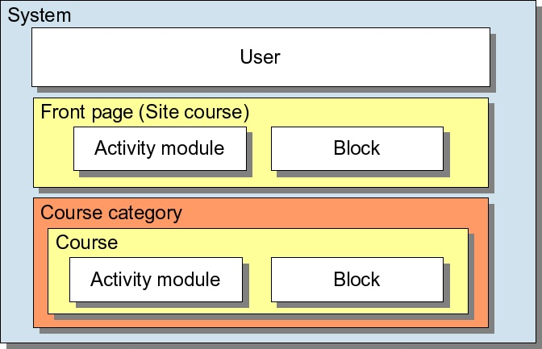
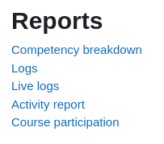
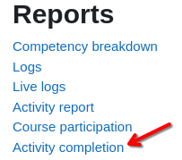

# Internal Data Model - Documentation

## General

### GroupMode
Groups are used to divide students into groups within a course. The group mode defines how these groups are set up.  
Generally, the group mode can be set at the course level (`Course.cs`) and overridden at the activity level (`Activities/Activity.cs`).  

The group mode can be forced at the course level (see property `ForceGroupMode` in `Course.cs`), which means that the GroupMode can no longer be changed at the activity level.

| Value in Data Model | Value in Moodle XML | Description                                                                       |
|---------------------|---------------------|-----------------------------------------------------------------------------------|
| NoGroups            | 0                   | no groups are used in the course                                                  |
| SeparateGroups      | 1                   | students are divided into separate groups and can only see their own groups' work |
| VisibleGroups       | 2                   | students are divided into separate groups but can see other groups' work          |

See [moodle docs](https://docs.moodle.org/405/en/Groups#Group_modes) for more information

### Context
In Moodle, users can have different permissions in different places. For example, a user might be a Teacher in one course, and a Student in another, and so have different permissions in each place. These places are called contexts. 
Contexts are hierarchical, meaning they form a tree-like structure, with permissions inheriting downwards unless overridden.

| Value in Data Model | Value in Moodle XML | Description                                                                                      |
|---------------------|---------------------|--------------------------------------------------------------------------------------------------|
| System              | 10                  | highest hierarchy level, applies site-wide                                                       |
| User                | 30                  | the standard permission of a user are defined in their own context (uncertain information)       |
| CourseCategory      | 40                  |                                                                                                  |
| Course              | 50                  |                                                                                                  |
| Module              | 70                  | also called "Activity module", appears within courses or within the 'site' course (= front page) |
| Block               | 80                  | appear within courses or within the 'site' course (= front page), lowest hierarchy level         |

See [moodle docs](https://docs.moodle.org/405/en/Context) for more information

### Archetypes
Archetypes are blueprints for roles. They define a standard set of permissions that serve as a starting point for creating custom roles.  
There is no archetype for the administrator, as it is a special role that is not assigned to a user in the same way as other roles.

| Value in Data Model          | Value in Moodle XML | Description                                    |
|------------------------------|---------------------|------------------------------------------------|
| Manager                      | manager             | lesser administrator role                      |
| CourseCreator                | coursecreator       | can create courses                             |
| EditingTeacher               | editingteacher      | can manage and add content to courses          |
| NonEditingTeacher            | teacher             | can grade in courses but not edit them         |
| Student                      | student             | can access and participate in courses          |
| Guest                        | guest               | can view courses but not participate           |
| AuthenticatedUser            | user                | the role all logged-in users have              |
| AuthenticatedUserOnFrontpage | frontpage           | a logged-in user role for the front page only  |

See [moodle docs #1](https://docs.moodle.org/405/en/Creating_custom_roles#Role_archetypes) and [moodle docs #2](https://docs.moodle.org/405/en/Standard_roles) for more information

### Enrolment
The process of adding students to courses is called Enrolment. There are various methods of enrolling students into courses, once they have logged in to Moodle (= Enrolment methods):

| Subclass in Data Model | Value in Moodle XML | Description                                                |
|------------------------|---------------------|------------------------------------------------------------|
| GuestEnrolment         | guest               | users can view course materials but not participate        |
| ManualEnrolment        | manual              | the administrator or course teacher adds users manually    |
| SelfEnrolment          | self                | a user can choose to enrol him/herself into a course       |
| CohortSync             | TBD                 | users are part of a Cohort which is added to the course    |
| CourseMetaLink         | TBD                 | users enrolled in other courses are given automatic access |
| CategoryEnrolment      | TBD                 | users are enrolled in all courses in a category            |
| ExternalDatabase       | TBD                 | users are enrolled from a database such as Access, MySQL   |
| FlatFile               | TBD                 | users are enrolled with a csv file                         |
| IMSEnterprise          | TBD                 | users are enrolled with this standard XML file format      |
| LDAPEnrolment          | TBD                 | users are authenticated and then enrolled through LDAP     |
| MNetEnrolment          | TBD                 | users are enrolled via a linked Moodle site                |
| PayPalEnrolment        | TBD                 | users purchase enrolment with Paypal                       |

Only Guest Enrolment, Manual Enrolment and Self Enrolment are provided by Moodle core, the other methods are provided by plugins.  
See [moodle docs #1](https://docs.moodle.org/405/en/Course_enrolment), [moodle docs #2](https://docs.moodle.org/405/en/Enrolment_methods) and [moodle docs #3](https://docs.moodle.org/2x/pl/Enrolments) for more information

### FormattingFormat
Moodle provides text fields in various places where text can be saved.  
For many of these texts, the format in which they are stored must be specified in the backup.

| Value in Data Model | Value in Moodle XML | Description                                                                          |
|---------------------|---------------------|--------------------------------------------------------------------------------------|
| MoodleAutoFormat    | 0                   | see [moodle docs](https://docs.moodle.org/405/en/Formatting_text#Moodle_auto-format) |
| HTML                | 1                   | text saved as HTML                                                                   |
| PlainText           | 2                   | text saved as plain text                                                             |
| Markdown            | 4                   | text saved as Markdown                                                               |

See [moodle docs](https://docs.moodle.org/405/en/Formatting_text) for more information

## Course.cs

### CourseFormat
The course format refers to the layout of a course. 

| Value in Data Model   | Value in Moodle XML | Description                                                |
|-----------------------|---------------------|------------------------------------------------------------|
| CustomSections        | topics              | course is divided into customisable sections               |
| WeeklySections        | weeks               | course is divided into sections corresponding to each week |
| SingleActivity        | singleactivity      | course contains only one activity or resource              |
| Social                | social              | course is centred around a main forum on the course page   |

See [moodle docs](https://docs.moodle.org/405/en/Course_formats) for more information

### NumberOfAnnouncementsToDisplay  
The Announcements forum is a special forum for general news and announcements. By default, it is placed at the top of the course and only teachers and users with appropriate permissions (by default teachers) can post in it.  The forum has forced subscription set by default.  

The [latest announcements block](https://docs.moodle.org/405/en/Latest_announcements_block) displays a specific number of recent discussions from the Announcements forum. 

| Value in Data Model | Value in Moodle XML | Description                                                                       |
|---------------------|---------------------|-----------------------------------------------------------------------------------|
| 0                   | 0                   | disables the announcements forum                                                  |
| 1                   | 1                   | only the most recent announcement is displayed in the latest announcements block  |
| 2                   | 2                   | the two most recent announcements are displayed in the latest announcements block |
| ...                 | ...                 | ...                                                                               |

The default value for this field is `3`.  

See [moodle docs](https://docs.moodle.org/405/en/Announcements_forum) for more information

### CourseIdNumber  
Warning: Not to be confused with the `Id` field!

The ID number can be used to match this course against an external system's ID, as a course catalogue ID or in the certificate module as a printed field.  
Unlike the `Id` field, the `CourseIdNumber` is optional.

See [moodle docs](https://docs.moodle.org/405/en/Course_settings#Course_ID_number) for more information

### MaximumUploadSize  
The default maximum upload size for student submissions for all activities in this course  
Can still be modified manually for each activity.

Values need to be specified in bytes. Use [MB to Bytes Conversion](https://www.gbmb.org/mb-to-bytes) and [KB to Bytes Conversion](https://www.gbmb.org/kb-to-bytes).

| Value in Data Model | Value in Moodle XML | Description                                            |
|---------------------|---------------------|--------------------------------------------------------|
| 0                   | 0                   | no limit -> maximum upload size supported by webserver |
| 20971520            | 20971520            | Upload size limit of 20 MB                             |
| 512000              | 512000              | Upload size limit of 500 KB                            |
| ...                 | ...                 | ...                                                    |

See [moodle docs](https://docs.moodle.org/405/en/File_upload_size) for more information

### Theme  
A single moodle course can use a different theme than the default theme of the whole moodle site (has to be enabled in administrator settings). If the course should use a custom theme, it should be specified here.

The value must match the name of a theme in the Moodle installation, see [moodle docs](https://moodledev.io/docs/4.4/apis/plugintypes/theme#getting-your-theme-to-appear-correctly-in-theme-selector)  

| Value in Data Model | Value in Moodle XML | Description                                                                                                            |
|---------------------|---------------------|------------------------------------------------------------------------------------------------------------------------|
| moove               | moove               | course uses the [moove theme](https://moodle.org/plugins/theme_moove) (even if the moodle site uses a different theme) |
| ...                 | ...                 | ...                                                                                                                    |

### Enable Completion tracking
If enabled, the completion status for each activity can be tracked by teachers and students  
See [moodle docs](https://docs.moodle.org/405/en/Tracking_progress) for more information

### ShowActivityCompletionConditions  
If enabled, the teacher can set and students will be able to see a list of what they must do to complete an activity  
The more precise configuration of this feature takes place at the activity level.

See [moodle docs #1](https://docs.moodle.org/405/en/Activity_completion) and [moodle docs #2](https://docs.moodle.org/405/en/Activity_completion_settings)  

### UsesLegacyFiles  
Moodle uses a "new" file system since version 2.0. This setting tells Moodle if this backup uses the new or old file system

| Value in Data Model | Value in Moodle XML | Description                                       |
|---------------------|---------------------|---------------------------------------------------|
| false               | 0                   | backup uses the new file system (no legacy files) |
| true                | 1                   | backup uses the old file system                   |

See [moodle docs](https://docs.moodle.org/405/en/Legacy_course_files) for more information

### CourseLanguage  
By default, Moodle detects a user's language from their browser setting and displays the course in the corresponding language.  
Using this setting, the teacher can force the course to use a specific language setting  

| Value in Data Model | Value in Moodle XML | Description                                      |
|---------------------|---------------------|--------------------------------------------------|
| `Null`              | ` `                 | don't force a language                           |
| English             | en                  | force the course page to be displayed in English |

### CourseCategory  
Course categories are used to organize courses into descriptive categories, making them easier to find for teachers and students. The default course category on a new Moodle site is `Category 1`.  
A course can (and must) only be in one category at a time.

See [moodle docs](https://docs.moodle.org/405/en/Course_categories) for more information

### Custom Fields  
Custom fields can be used to create field types to be used for custom fields. Instances of these field types can be added to the respective areas that implement Custom fields API.  

See [moodle docs](https://moodledev.io/docs/4.4/apis/plugintypes/customfield) for more information

| Value in Data Model | Value in Moodle XML | Description                           |
|---------------------|---------------------|---------------------------------------|
| `Null`              | ` `                 | Course does not use any custom fields |
| TBD                 | TBD                 | TBD                                   |

### PdfExportFont
Used to specify a custom font for PDF Exports. Only relevant for languages with non-latin scripts (e.g. Arabic, Chinese, Japanese, Korean, etc.) to ensure that the text is displayed correctly in the PDF.

See [moodle docs](https://docs.moodle.org/405/en/Language_settings#Enable_PDF_fonts) for more information

## User.cs

### EnrolmentSuspended
Suspended users are no longer able to access any of their courses on Moodle but their data is preserved, so it is possible for them to return to their course at a later time.

| Value in Data Model | Value in Moodle XML | Description                 |
|---------------------|---------------------|-----------------------------|
| false               | 0                   | Enrolment Status: Active    |
| true                | 1                   | Enrolment Status: Suspended |

See [moodle docs](https://docs.moodle.org/405/en/Unenrolment#Suspended_or_Unenrolled?) for more information

