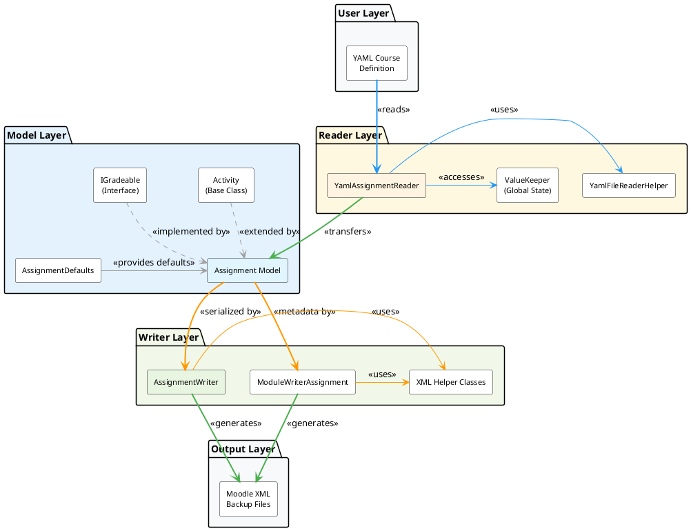

# [Assignment Developer Facing](https://docs.moodle.org/500/en/Assignment_activity)
The **Assignment Activity** is a component of the Course as Code system, enabling educators to create assignments for student submission and grading. This comprehensive guide provides developers with detailed information about the architecture, data models, and implementation patterns used in the Assignment Activity.

## Table of Contents

- [Architecture Overview](#architecture-overview)
- [Data Models in Detail](#data-models-in-detail)
- [Default Values](#default-values)
- [Readers](#readers)
- [Writers](#writers)


## Architecture Overview

The Assignment Activity follows a **three-tier architecture pattern** that promotes separation of concerns and maintainability. This pattern is consistent across all activities in the Course as Code system.

### Architecture Layers



### Layer Responsibilities

1. **Model Layer** (Assignment.cs)
   - Defines the complete data structure for assignments
   - Provides strongly-typed properties with validation through data annotations
   - Inherits common activity behavior from the `Activity` base class
   - Implements grading functionality through the `IGradeable` interface
   - Encapsulates business logic and data constraints

2. **Reader Layer** (YamlAssignmentReader.cs)
   - Deserializes YAML course definitions into Assignment objects
   - Performs data transformation from YAML format to internal model
   - Applies default values using the null-coalescing operator (`??`)
   - Integrates grading information from the `ValueKeeper` global state manager
   - Validates input data and logs errors for troubleshooting
   - Separates the concern of "how to read" from "what to read"

3. **Writer Layer** (AssignmentWriter.cs)
   - Serializes Assignment objects into Moodle-compatible XML format
   - Generates structured XML documents following Moodle's backup schema
   - Converts internal data representations (e.g., enums, DateTimes) to Moodle formats
   - Handles complex nested structures (submissions, overrides, plugin configs)
   - Writes both activity-specific files (`assign.xml`) and module metadata (`module.xml`)

### Key Relationships

**Inheritance Relationships:**
- `Assignment` inherits from `Activity` (abstract base class) - This provides all common activity properties like Name, Description, Visibility, etc.
- `Assignment` implements `IGradeable` interface - This adds comprehensive grading capabilities including grade categories, grade scales, and grade book integration.

**Composition Relationships:**
- `Assignment` contains a list of `AssignmentSubmission` objects (0 to many) - Each submission represents a student's work submission for the assignment
- `Assignment` contains a list of `AssignmentOverride` objects (0 to many) - Overrides allow customized deadlines for specific students or groups
- `Assignment` contains a list of `PluginConfig` objects (0 to many) - Plugin configurations enable extended functionality through Moodle plugins
- `Assignment` contains `SensibleDefaultsAssignment` and `SystemDefaultsAssignment` objects - These nested objects handle Moodle-specific default values

**Reference Relationships:**
- `Assignment` references a `GradeCategory` - Links the assignment to a specific category in the grade book for organization and grade aggregation

### Benefits of This Architecture

- **Maintainability**: Each layer has a single, well-defined responsibility
- **Testability**: Layers can be tested independently with mocks
- **Extensibility**: New input formats (JSON, XML) or output formats can be added without changing the model
- **Reusability**: The same model can be used for different readers and writers
- **Separation of Concerns**: Business logic (Model) is separated from I/O operations (Readers/Writers)

---
## Data Models in Detail

### Assignment Class

The `Assignment` class is the primary data model for representing assignment activities in the Course as Code system. Located in [Assignment.cs](CourseAsCode.Model/Activities/Resources/Assignment.cs), it serves as the central data structure that flows through the entire system from reading YAML files to writing Moodle XML backups.

#### Class Declaration and Inheritance


These properties control the basic presentation and behavior of the assignment.

```csharp
    [Description("Introduction text for the assignment")]
    public string Intro { get; set; } = AssignmentDefaults.DEFAULT_INTRO;

    [Description("Format of the introduction text (e.g., HTML, PlainText)")]
    public FormattingFormat FormattingFormat { get; set; } = AssignmentDefaults.DEFAULT_FORMATTING_FORMAT;

    [Description("Whether to always show the description")]
    public bool AlwaysShowDescription { get; set; } = AssignmentDefaults.DEFAULT_ALWAYS_SHOW_DESCRIPTION;
```

These properties manage how students submit their work and when submissions are accepted.

```csharp
    [Description("Whether submission drafts are allowed")]
    public bool SubmissionDrafts { get; set; } = AssignmentDefaults.DEFAULT_SUBMISSION_DRAFTS;

    [Description("Whether to send notifications to teachers")]
    public bool SendNotifications { get; set; } = AssignmentDefaults.DEFAULT_SEND_NOTIFICATIONS;

    [Description("Whether to send late submission notifications")]
    public bool SendLateNotifications { get; set; } = AssignmentDefaults.DEFAULT_SEND_LATE_NOTIFICATIONS;

    [Description("Whether to send notifications to students")]
    public bool SendStudentNotifications { get; set; } = AssignmentDefaults.DEFAULT_SEND_STUDENT_NOTIFICATIONS;

    [Description("The due date for the assignment")]
    public DateTime? DueDate { get; set; } = AssignmentDefaults.DEFAULT_DUE_DATE;

    [Description("The cutoff date for the assignment")]
    public DateTime? CutoffDate { get; set; } = AssignmentDefaults.DEFAULT_CUTOFF_DATE;

    [Description("The grading due date for the assignment")]
    public DateTime? GradingDueDate { get; set; } = AssignmentDefaults.DEFAULT_GRADING_DUE_DATE;

    [Description("The date from which submissions are allowed")]
    public DateTime? AllowSubmissionsFromDate { get; set; } = AssignmentDefaults.DEFAULT_ALLOW_SUBMISSIONS_FROM_DATE;
```

These properties integrate the assignment with Moodle's gradebook system, enabling sophisticated grade management and calculation.

```csharp
    [Description("the name with which the assignment will be displayed in the gradebook")]
    public string? GradeName { get; set; } = AssignmentDefaults.DEFAULT_GRADE_NAME;

    [Description("general information about the assignment grade item; optional and will NOT be displayed in the gradebook")]
    public string? GradeInfo { get; set; } = AssignmentDefaults.DEFAULT_GRADE_INFO;

    [Description("The GradeCategory this assignment belongs to")]
    public GradeCategory GradeCategory { get; set; } = AssignmentDefaults.DEFAULT_GRADE_CATEGORY;

    [Description("the minimum amount of points that CAN be earned in this assignment | only applicable when using the 'Value' GradeType")]
    public float? MinGrade { get; set; } = AssignmentDefaults.DEFAULT_GRADE_MINIMUM;

    [Description("the maximum amount of points that CAN be earned for this assignment | only applicable when using the 'Value' GradeType")]
    public float MaxGrade { get; set; } = AssignmentDefaults.DEFAULT_GRADE_MAXIMUM;

    [Description("The minimum number of points that HAS to be earned in this assignment to pass, null for no passing grade")]
    public float? GradeToPass { get; set; } = AssignmentDefaults.DEFAULT_GRADE_TO_PASS;

    [Description("how the assignment is graded")]
    public GradeType GradeType { get; set; } = AssignmentDefaults.DEFAULT_GRADE_TYPE;

    [Description("The weight of this assignment in the grade calculation of its GradeCategory in % of 100, null for default weight")]
    public int? GradingWeight { get; set; } = AssignmentDefaults.DEFAULT_GRADE_WEIGHT;

    [Description("specifies the number of decimal points to display for the grade | has no effect on grade calculations, which are made with an accuracy of 5 decimal places")]
    public int? GradeDecimalPoints { get; set; } = AssignmentDefaults.DEFAULT_GRADE_DECIMAL_POINTS;

    [Description("Factor by which the grade for this activity will be multiplied, with a maximum value of the maximum grade")]
    public float? GradeMultiplicator { get; set; } = AssignmentDefaults.DEFAULT_GRADE_MULTIPLICATOR;

    [Description("Number that will be added to the grade of this activity, after the Multiplicator is applied")]
    public float? GradeOffset { get; set; } = AssignmentDefaults.DEFAULT_GRADE_OFFSET;

    [Description("whether this activity should be hidden from students in the gradebook")]
    public bool GradeHidden { get; set; } = AssignmentDefaults.DEFAULT_HIDE_GRADE;

    [Description("An optional date after which the activity will no longer be hidden in the gradebook")]
    public DateTime? GradeHiddenUntil { get; set; } = AssignmentDefaults.DEFAULT_GRADE_HIDDEN_UNTIL;

    [Description("Whether or not to lock the grading for this activity")]
    public bool GradingLocked { get; set; } = AssignmentDefaults.DEFAULT_LOCKED_GRADE;

    [Description("A date after which the locking will be effective")]
    public DateTime? GradingLockedAfter { get; set; } = AssignmentDefaults.DEFAULT_GRADE_LOCKED_UNTIL;
```

**Grade Display:**
- **`GradeName`**: Custom name shown in the gradebook (defaults to assignment name if null)
- **`GradeInfo`**: Internal notes about grading, not visible to students (for documentation purposes)

**Grade Scale Configuration:**
- **`GradeType`**: Determines the grading method:
  - `GradeType.Value` - Numeric points (e.g., 0-100)
  - `GradeType.Scale` - Predefined scale (e.g., "Excellent, Good, Fair, Poor")
  - `GradeType.None` - No grading, only for completion tracking

- **`MinGrade` / `MaxGrade`**: Define the grade range. For example:
  - MinGrade = 0, MaxGrade = 100 (typical percentage scale)
  - MinGrade = 1, MaxGrade = 10 (1-10 scale)
  - MinGrade = null (defaults to 0)

- **`GradeToPass`**: Minimum grade required for passing. Used in:
  - Course completion criteria
  - Conditional access to other activities
  - Progress tracking and reports
  - **Example**: GradeToPass = 60 (need 60% to pass)

**Grade Category Integration:**
- **`GradeCategory`**: Links this assignment to a category in the gradebook. Grade categories enable:
  - Hierarchical organization of grades
  - Weighted aggregation of grades within categories
  - Separate grade reports by category (e.g., "Homework", "Exams", "Projects")
  - Example: All weekly assignments belong to "Homework" category (30% of final grade)

- **`GradingWeight`**: Percentage weight within its category (0-100). If null, equal weighting is used.
  - Example: Final exam with GradingWeight = 50 counts twice as much as a quiz with GradingWeight = 25

**Grade Transformations:**

Moodle supports complex grade transformations for flexible grading schemes:

- **`GradeMultiplicator`**: Multiplies the earned grade by this factor
  - Example: Multiplicator = 2 converts a 50-point assignment to 100 points
  - Applied before offset
  - Result is capped at `MaxGrade`

- **`GradeOffset`**: Adds (or subtracts if negative) a fixed value to the grade
  - Example: Offset = 10 gives everyone a 10-point bonus
  - Applied after multiplicator
  - Can be negative for penalties

**Grade Transformation Formula:**
```
FinalGrade = min((EarnedGrade × GradeMultiplicator) + GradeOffset, MaxGrade)
```

**Grade Visibility Control:**
- **`GradeHidden`**: When `true`, grades are hidden from students but still recorded
- **`GradeHiddenUntil`**: Automatically reveals grades after this date
  - Useful for: "Grades will be released on Friday at 5 PM"
  - Allows batch grading without revealing incomplete results

**Grade Locking:**
- **`GradingLocked`**: When `true`, prevents changes to grades and settings
  - Protects finalized grades from accidental modification
  - Typically used after grade appeals period ends
  
- **`GradingLockedAfter`**: Automatically locks grading after this date
  - Example: Lock grades 2 weeks after semester ends*`CutoffDate`**: The absolute final deadline. After this date:
  - No submissions are accepted under any circumstances
  - The submission interface is disabled
  - Typically set a few days after the due date to allow for late submissions with penalty

- **`GradingDueDate`**: A reminder date for teachers/graders indicating when grading should be completed. This doesn't affect student submissions but appears in teacher notifications and dashboards.

**Date Relationship:**

**General Settings**

These properties control the basic presentation and user-facing content of the assignment.

```csharp
[Description("Introduction text for the assignment")]
public string Intro { get; set; } = AssignmentDefaults.DEFAULT_INTRO;

[Description("Format of the introduction text (e.g., HTML, PlainText)")]
public FormattingFormat FormattingFormat { get; set; } = AssignmentDefaults.DEFAULT_FORMATTING_FORMAT;

[Description("Whether to always show the description")]
public bool AlwaysShowDescription { get; set; } = AssignmentDefaults.DEFAULT_ALWAYS_SHOW_DESCRIPTION;
```

**Property Explanations:**

- **`Intro`** (string): Contains the main instructional text for the assignment. This is the primary content students see when opening the assignment. It can include:
  - Assignment requirements and objectives
  - Submission guidelines and formatting requirements
  - Grading criteria and rubrics
  - Resource links and reference materials
  - The text format is determined by `FormattingFormat`

- **`FormattingFormat`** (enum): Specifies how the `Intro` text should be interpreted and rendered:
  - `FormattingFormat.HTML` - Full HTML markup support (default)
  - `FormattingFormat.PlainText` - No formatting, displays as plain text
  - `FormattingFormat.Markdown` - Markdown syntax support
  - `FormattingFormat.Moodle` - Moodle's auto-format (converts line breaks, URLs)

- **`AlwaysShowDescription`** (bool): Controls the visibility of the `Intro` text on the course page:
  - `true` - Description is displayed directly on the course page (default)
  - `false` - Description is only shown after clicking into the assignment
  - Useful for keeping course pages uncluttered with long descriptions

**Default Values:**
```csharp
DEFAULT_INTRO = "";                                    // Empty string
DEFAULT_FORMATTING_FORMAT = FormattingFormat.HTML;     // HTML formatting
DEFAULT_ALWAYS_SHOW_DESCRIPTION = true;                // Always visible
```

---

**Submission Settings**

These properties manage the submission workflow, including draft submissions, notification behavior, and submission deadlines.

```csharp
[Description("Whether submission drafts are allowed")]
public bool SubmissionDrafts { get; set; } = AssignmentDefaults.DEFAULT_SUBMISSION_DRAFTS;

[Description("Whether to send notifications to teachers")]
public bool SendNotifications { get; set; } = AssignmentDefaults.DEFAULT_SEND_NOTIFICATIONS;

[Description("Whether to send late submission notifications")]
public bool SendLateNotifications { get; set; } = AssignmentDefaults.DEFAULT_SEND_LATE_NOTIFICATIONS;

[Description("Whether to send notifications to students")]
public bool SendStudentNotifications { get; set; } = AssignmentDefaults.DEFAULT_SEND_STUDENT_NOTIFICATIONS;

[Description("The due date for the assignment")]
public DateTime? DueDate { get; set; } = AssignmentDefaults.DEFAULT_DUE_DATE;

[Description("The cutoff date for the assignment")]
public DateTime? CutoffDate { get; set; } = AssignmentDefaults.DEFAULT_CUTOFF_DATE;

[Description("The grading due date for the assignment")]
public DateTime? GradingDueDate { get; set; } = AssignmentDefaults.DEFAULT_GRADING_DUE_DATE;

[Description("The date from which submissions are allowed")]
public DateTime? AllowSubmissionsFromDate { get; set; } = AssignmentDefaults.DEFAULT_ALLOW_SUBMISSIONS_FROM_DATE;
```

**Draft Submission System:**

- **`SubmissionDrafts`** (bool): Enables or disables the draft submission feature
  - `false` - Students submit directly, changes are immediate (default)
  - `true` - Students can save work as drafts before final submission
  - When enabled:
    - Students can save multiple draft versions
    - Drafts are not visible to teachers
    - Students must explicitly click "Submit assignment" to finalize
    - Useful for multi-part assignments or longer work periods
    - Students can edit drafts unlimited times before submission

**Notification Configuration:**

The assignment system can send email notifications to various parties at different stages. All notification properties are boolean flags:

- **`SendNotifications`** (bool): Controls teacher/grader notifications
  - `false` - No emails sent to teachers (default)
  - `true` - Teachers receive email when students submit
  - Notification includes: student name, submission time, assignment name
  - Useful for time-sensitive assignments requiring prompt feedback

- **`SendLateNotifications`** (bool): Specialized notifications for late submissions
  - `false` - Late submissions are silent (default)
  - `true` - Additional notification sent when submission is after `DueDate`
  - Helps teachers prioritize grading and track late patterns
  - Only triggers if `DueDate` is set and submission occurs after it

- **`SendStudentNotifications`** (bool): Student confirmation and feedback emails
  - `false` - Students receive no email confirmations (default)
  - `true` - Students receive emails for:
    - Submission confirmation (with submission details)
    - Grade release notifications
    - Feedback availability notifications
  - Provides students with a permanent record of their submission

**Date Management System:**

The assignment uses a sophisticated four-date system to control submission timing. All dates are nullable (`DateTime?`), meaning they can be `null` (no restriction) or a specific date/time.

- **`AllowSubmissionsFromDate`** (DateTime?): The earliest possible submission time
  - `null` - Submissions can start immediately when assignment is available (default)
  - Set date - Students cannot submit before this date
  - Use cases:
    - Prevent early submissions until prerequisite work is complete
    - Stagger assignment releases in a course
    - Ensure students have attended relevant lectures
  - Student UI shows: "This assignment will accept submissions from [date]"

- **`DueDate`** (DateTime?): The target deadline for submission
  - `null` - No official deadline, submissions always accepted (default)
  - Set date - Primary deadline displayed prominently to students
  - After `DueDate`:
    - Submissions are still accepted (unless `CutoffDate` prevents it)
    - Submissions are marked as "late" in the system
    - Late notification emails are triggered (if `SendLateNotifications = true`)
    - Teachers can see which submissions are late
  - Most important date for students - typically used in all assignments

- **`CutoffDate`** (DateTime?): The absolute final deadline
  - `null` - No cutoff, submissions accepted indefinitely (default)
  - Set date - Hard deadline, no submissions accepted after this point
  - After `CutoffDate`:
    - Submit button is disabled in student UI
    - Students see: "This assignment is no longer accepting submissions"
    - No exceptions possible without admin intervention
  - Typically set a few days/hours after `DueDate`
  - Use cases:
    - Final exam - allow 2 hours past start time
    - Weekly assignment - allow 2 days grace period after due date
    - Project submission - hard deadline for grading to begin

- **`GradingDueDate`** (DateTime?): Teacher/grader reminder date
  - `null` - No grading deadline specified (default)
  - Set date - Internal deadline for teachers to complete grading
  - This date does NOT affect students or their ability to submit
  - Purpose:
    - Appears in teacher dashboards and reminders
    - Helps course coordinators track grading progress
    - Can trigger reminder emails to grading staff
    - Useful for coordinating multi-grader assignments
  - Independent of other dates - can be before or after any other date


**Common Date Patterns:**

1. **Standard Assignment:**
   ```csharp
   AllowSubmissionsFromDate = DateTime.Parse("2026-01-15 08:00");  // Course start
   DueDate = DateTime.Parse("2026-01-22 23:59");                    // 1 week
   CutoffDate = DateTime.Parse("2026-01-24 23:59");                 // 2 days grace
   GradingDueDate = DateTime.Parse("2026-01-29 17:00");             // 1 week to grade
   ```

2. **Timed Exam:**
   ```csharp
   AllowSubmissionsFromDate = DateTime.Parse("2026-02-10 10:00");  // Exam start
   DueDate = DateTime.Parse("2026-02-10 12:00");                    // 2 hours
   CutoffDate = DateTime.Parse("2026-02-10 12:15");                 // 15 min grace
   GradingDueDate = DateTime.Parse("2026-02-15 17:00");             // Quick turnaround
   ```

3. **Flexible Project:**
   ```csharp
   AllowSubmissionsFromDate = null;                                 // Start anytime
   DueDate = DateTime.Parse("2026-03-15 23:59");                    // Soft deadline
   CutoffDate = null;                                               // No hard cutoff
   GradingDueDate = DateTime.Parse("2026-03-20 17:00");             // Grade by this date
   ```

**Default Values:**
```csharp
DEFAULT_SUBMISSION_DRAFTS = false;              // Direct submission
DEFAULT_SEND_NOTIFICATIONS = false;             // No teacher emails
DEFAULT_SEND_LATE_NOTIFICATIONS = false;        // No late emails
DEFAULT_SEND_STUDENT_NOTIFICATIONS = false;     // No student emails
DEFAULT_DUE_DATE = null;                        // No deadline
DEFAULT_CUTOFF_DATE = null;                     // No cutoff
DEFAULT_GRADING_DUE_DATE = null;                // No grading deadline
DEFAULT_ALLOW_SUBMISSIONS_FROM_DATE = null;     // Allow immediately
```

---

**Team Submission Settings**
```csharp
[Description("Whether team submissions are allowed")]
public bool TeamSubmission { get; set; } = AssignmentDefaults.DEFAULT_TEAM_SUBMISSION;

[Description("Whether all team members must submit")]
public bool RequireAllTeamMembersSubmit { get; set; } = AssignmentDefaults.DEFAULT_REQUIRE_ALL_TEAM_MEMBERS_SUBMIT;

[Description("Grouping ID for team submissions")]
public int TeamSubmissionGroupingId { get; set; } = AssignmentDefaults.DEFAULT_TEAM_SUBMISSION_GROUPING_ID;
```

**Marking Settings**
```csharp
[Description("Whether blind marking is enabled")]
public bool BlindMarking { get; set; } = AssignmentDefaults.DEFAULT_BLIND_MARKING;

[Description("Whether the grader is hidden")]
public bool HideGrader { get; set; } = AssignmentDefaults.DEFAULT_HIDE_GRADER;

[Description("Whether identities are revealed after grading")]
public bool RevealIdentities { get; set; } = AssignmentDefaults.DEFAULT_REVEAL_IDENTITIES;

[Description("Method for reopening attempts")]
public string AttemptReopenMethod { get; set; } = AssignmentDefaults.DEFAULT_ATTEMPT_REOPEN_METHOD;

[Description("Maximum number of attempts allowed")]
public int MaxAttempts { get; set; } = AssignmentDefaults.DEFAULT_MAX_ATTEMPTS;

[Description("Whether marking workflow is enabled")]
public bool MarkingWorkflow { get; set; } = AssignmentDefaults.DEFAULT_MARKING_WORKFLOW;

[Description("Whether marking allocation is enabled")]
public bool MarkingAllocation { get; set; } = AssignmentDefaults.DEFAULT_MARKING_ALLOCATION;
```
**Key Implementation Details:**

1. **Null-Coalescing Pattern**: The reader uses the null-coalescing operator (`??`) extensively:
   ```csharp
   Intro = yamlAssignment.Intro ?? AssignmentDefaults.DEFAULT_INTRO
   ```
   This ensures that if a property is not specified in the YAML file, the system falls back to a sensible default value rather than using null or throwing an error.

2. **Two-Stage Initialization**:
   - First stage: Convert YAML structure to Assignment model
   - Second stage: Enrich with grading information from `ValueKeeper`
   
   This separation allows grading to be configured independently from the assignment definition.

3. **ValueKeeper Integration**: The `ValueKeeper` is a singleton/global state manager that maintains cross-cutting information during the read process:
   - `CurrentActivityId`: Auto-incrementing ID for activities
   - `CurrentModuleId`: Auto-incrementing ID for modules
   - `GradingInfos`: Grading configurations for activities
   - `GradeCategories`: Defined grade categories
   
   This allows the reader to access context that spans multiple files.


___ 

**AssignmentSubmission Class**
```csharp
public class AssignmentSubmission
{
    public int SubmissionId { get; set; }
    public int UserId { get; set; }
    public DateTime TimeCreated { get; set; }
    public DateTime? TimeModified { get; set; }
    public string? TimeStarted { get; set; }
    public string Status { get; set; } = string.Empty;
    public int GroupId { get; set; }
    public int AttemptNumber { get; set; }
    public bool IsLatest { get; set; }
}
```

**AssignmentOverride Class**
```csharp
public class AssignmentOverride
{
    public int OverrideId { get; set; }
    public int UserId { get; set; }
    public DateTime? DueDate { get; set; }
    public DateTime? CutoffDate { get; set; }
}
```

**PluginConfig Class**
```csharp
public class PluginConfig
{
    public int ConfigId { get; set; }
    public string PluginName { get; set; } = string.Empty;
    public string Subtype { get; set; } = string.Empty;
    public string Name { get; set; } = string.Empty;
    public string Value { get; set; } = string.Empty;
}
```

## Default Values

The [AssignmentDefaults.cs](CourseAsCode.Model/Defaults/Activities/Resources/AssignmentDefaults.cs) class provides sensible default values for all Assignment properties:

```csharp
public class AssignmentDefaults
{
    // General Settings
    public const string DEFAULT_INTRO = "";
    public const FormattingFormat DEFAULT_FORMATTING_FORMAT = FormattingFormat.HTML;
    public const bool DEFAULT_ALWAYS_SHOW_DESCRIPTION = true;

    // Submission Settings
    public const bool DEFAULT_SUBMISSION_DRAFTS = false;
    public const bool DEFAULT_SEND_NOTIFICATIONS = false;
    public const bool DEFAULT_SEND_LATE_NOTIFICATIONS = false;
    public const bool DEFAULT_SEND_STUDENT_NOTIFICATIONS = false;
    public static readonly DateTime? DEFAULT_DUE_DATE = null;
    public static readonly DateTime? DEFAULT_CUTOFF_DATE = null;
    public static readonly DateTime? DEFAULT_GRADING_DUE_DATE = null;
    public static readonly DateTime? DEFAULT_ALLOW_SUBMISSIONS_FROM_DATE = null;

    // Grading Settings
    public const bool DEFAULT_COMPLETION_SUBMIT = true;
    public const bool DEFAULT_REQUIRE_SUBMISSION_STATEMENT = false;

    // IGradeable Defaults
    public const string? DEFAULT_GRADE_NAME = null;
    public const string? DEFAULT_GRADE_INFO = null;
    public static readonly GradeCategory DEFAULT_GRADE_CATEGORY = new GradeCategory()
    {
        GradeCategoryId = 1,
        GradeName = "Course Overall",
        AggregationType = GradeAggregation.Natural,
        Created = DateTime.Now,
        Modified = DateTime.Now,
    };
    public const float DEFAULT_GRADE_TO_PASS = 0.0f;
    public static readonly int? DEFAULT_GRADE_MINIMUM = null;
    public const float DEFAULT_GRADE_MAXIMUM = 100f;
    public static readonly int? DEFAULT_GRADE_WEIGHT = null;
    public const GradeType DEFAULT_GRADE_TYPE = GradeType.Value;

    // Team Submission Defaults
    public const bool DEFAULT_TEAM_SUBMISSION = false;
    public const bool DEFAULT_REQUIRE_ALL_TEAM_MEMBERS_SUBMIT = false;
    public const int DEFAULT_TEAM_SUBMISSION_GROUPING_ID = 0;

    // Marking Defaults
    public const bool DEFAULT_BLIND_MARKING = false;
    public const bool DEFAULT_HIDE_GRADER = false;
    public const bool DEFAULT_REVEAL_IDENTITIES = false;
    public const string DEFAULT_ATTEMPT_REOPEN_METHOD = "none";
    public const int DEFAULT_MAX_ATTEMPTS = 1;
    public const bool DEFAULT_MARKING_WORKFLOW = false;
    public const bool DEFAULT_MARKING_ALLOCATION = false;
}
```

## Readers

The Reader layer is responsible for transforming YAML course definitions into strongly-typed `Assignment` objects. This layer acts as the bridge between human-readable YAML files and the internal C# data model, handling deserialization, validation, and default value application.

### YamlAssignmentReader

The `YamlAssignmentReader` class is located in [YamlAssignmentReader.cs](CourseAsCode.Readers/YAML/Readers/YamlAssignmentReader.cs) and serves as the primary entry point for reading assignment data from YAML files.

#### Constructor and Dependencies

```csharp
private readonly IYamlFileReaderHelper _yamlFileReaderHelper;
private readonly ILogger _logger;

public YamlAssignmentReader(IYamlFileReaderHelper yamlFileReaderHelper, ILogger logger)
{
    _yamlFileReaderHelper = yamlFileReaderHelper ?? throw new ArgumentNullException(nameof(yamlFileReaderHelper));
    _logger = logger ?? throw new ArgumentNullException(nameof(logger));
}
```

**Dependencies Explained:**
- **`_yamlFileReaderHelper`**: A specialized helper class that encapsulates YAML deserialization logic
  - Handles file I/O operations
  - Manages YamlDotNet configuration (the library used for YAML parsing)
  - Provides consistent error handling across all YAML readers
  - Benefits: Centralized YAML logic, easier to mock for testing
- **`_logger`**: NLog logger instance for diagnostic output
  - Logs file access attempts
  - Records deserialization errors with full context
  - Helps trace issues during course import processes
- **Null checking**: Defensive programming ensures dependencies are properly injected (fails fast if misconfigured)

#### Main Read Method

```csharp
public Assignment Read(string modelObjectPath)
{
    // Step 1: Validate that the YAML file exists
    if (!File.Exists(modelObjectPath))
    {
        _logger.Error($"File {modelObjectPath} does not exist.");
        return null;  // Graceful failure - allows system to continue with other activities
    }

    // Step 2: Deserialize YAML to intermediate YamlAssignment object
    var yamlAssignment = _yamlFileReaderHelper.DeserializeFromFile<YamlAssignment>(modelObjectPath);

    // Step 3: Check if deserialization succeeded
    if (yamlAssignment == null)
    {
        _logger.Error($"Could not deserialize the file {modelObjectPath}.");
        return null;  // Prevents cascading failures from invalid YAML
    }

    // Step 4: Convert intermediate YAML model to final Assignment model
    var moodleAssignment = ConvertYamlAssignmentToMoodleAssignment(yamlAssignment);

    // Step 5: Check if grading information exists in ValueKeeper (global state)
    var grading = ValueKeeper.GradingInfos.FirstOrDefault(gi => gi.PathToActivity == modelObjectPath);

    // Step 6: Add grading configuration if found
    if (grading != null)
    {
        moodleAssignment = AddGradingToMoodleAssignment(moodleAssignment, grading);
    }

    // Step 7: Return fully constructed Assignment object
    return moodleAssignment;
}
```

**Key Design Patterns:**

1. **Null Object Pattern**: Returns `null` on failure instead of throwing exceptions, allowing the system to handle partial failures gracefully
2. **Two-Stage Deserialization**: 
   - Stage 1: YAML → `YamlAssignment` (intermediate model with YAML-friendly property names)
   - Stage 2: `YamlAssignment` → `Assignment` (final model with Moodle semantics)
   - Benefits: Separates YAML concerns from domain model, easier to maintain
3. **Global State Access**: Uses `ValueKeeper` to access grading information that may be defined in a separate file
4. **Early Exit**: Checks file existence before attempting deserialization (fail-fast principle)

#### Conversion Logic: YAML to Assignment Model

```csharp
private Assignment ConvertYamlAssignmentToMoodleAssignment(YamlAssignment yamlAssignment)
{
    return new Assignment()
    {
        // System-generated identifiers from ValueKeeper (global state)
        ActivityId = ValueKeeper.CurrentActivityId,
        ModuleId = ValueKeeper.CurrentModuleId,
        ModuleName = "assign",  // Constant for assignment activity type
        
        // Basic Information (direct mapping)
        Name = yamlAssignment.Name,
        Description = yamlAssignment.Description,
        
        // Intro with default fallback
        Intro = yamlAssignment.Intro ?? AssignmentDefaults.DEFAULT_INTRO,
        // If YAML doesn't specify Intro, use default value ("") from AssignmentDefaults
        
        // Formatting with enum conversion
        FormattingFormat = yamlAssignment.AssignmentTextFormat ?? AssignmentDefaults.DEFAULT_FORMATTING_FORMAT,
        // YAML: "HTML" → Enum: FormattingFormat.HTML → XML: "1"
        // Null-coalescing ensures a valid enum value is always present
        
        // Boolean properties with default fallbacks
        AlwaysShowDescription = yamlAssignment.AlwaysShowDescription ?? AssignmentDefaults.DEFAULT_ALWAYS_SHOW_DESCRIPTION,
        SubmissionDrafts = yamlAssignment.AllowSubmissionDrafts ?? AssignmentDefaults.DEFAULT_SUBMISSION_DRAFTS,
        SendNotifications = yamlAssignment.SendNotifications ?? AssignmentDefaults.DEFAULT_SEND_NOTIFICATIONS,
        SendLateNotifications = yamlAssignment.SendLateNotifications ?? AssignmentDefaults.DEFAULT_SEND_LATE_NOTIFICATIONS,
        SendStudentNotifications = yamlAssignment.SendStudentNotifications ?? AssignmentDefaults.DEFAULT_SEND_STUDENT_NOTIFICATIONS,
        
        // Date properties (DateTime objects)
        DueDate = yamlAssignment.DueDate ?? AssignmentDefaults.DEFAULT_DUE_DATE,
        // YAML: "2026-05-15T23:59:59" → DateTime object → Later converted to Unix timestamp
        CutoffDate = yamlAssignment.CutoffDate ?? AssignmentDefaults.DEFAULT_CUTOFF_DATE,
        AllowSubmissionsFromDate = yamlAssignment.AllowSubmissionsFromDate ?? AssignmentDefaults.DEFAULT_ALLOW_SUBMISSIONS_FROM_DATE,
        GradingDueDate = yamlAssignment.GradingDueDate ?? AssignmentDefaults.DEFAULT_GRADING_DUE_DATE,
        
        // Grading configuration
        MaxGrade = yamlAssignment.Grade ?? AssignmentDefaults.DEFAULT_GRADE_MAXIMUM,
        
        // Completion tracking
        CompletionSubmit = yamlAssignment.CompletionSubmit ?? AssignmentDefaults.DEFAULT_COMPLETION_SUBMIT,
        RequireSubmissionStatement = yamlAssignment.RequireSubmissionStatement ?? AssignmentDefaults.DEFAULT_REQUIRE_SUBMISSION_STATEMENT,
        
        // Team submission settings
        TeamSubmission = yamlAssignment.TeamSubmission ?? AssignmentDefaults.DEFAULT_TEAM_SUBMISSION,
        RequireAllTeamMembersSubmit = yamlAssignment.RequireAllTeamMembersSubmit ?? AssignmentDefaults.DEFAULT_REQUIRE_ALL_TEAM_MEMBERS_SUBMIT,
        TeamSubmissionGroupingId = yamlAssignment.TeamSubmissionGroupingId ?? AssignmentDefaults.DEFAULT_TEAM_SUBMISSION_GROUPING_ID,
        
        // Marking settings
        BlindMarking = yamlAssignment.BlindMarking ?? AssignmentDefaults.DEFAULT_BLIND_MARKING,
        HideGrader = yamlAssignment.HideGrader ?? AssignmentDefaults.DEFAULT_HIDE_GRADER,
        RevealIdentities = yamlAssignment.RevealIdentities ?? AssignmentDefaults.DEFAULT_REVEAL_IDENTITIES,
        MarkingWorkflow = yamlAssignment.MarkingWorkflow ?? AssignmentDefaults.DEFAULT_MARKING_WORKFLOW,
        MarkingAllocation = yamlAssignment.MarkingAllocation ?? AssignmentDefaults.DEFAULT_MARKING_ALLOCATION,
        
        // Attempt settings
        AttemptReopenMethod = yamlAssignment.AttemptReopenMethod ?? AssignmentDefaults.DEFAULT_ATTEMPT_REOPEN_METHOD,
        MaxAttempts = yamlAssignment.MaxAttempts ?? AssignmentDefaults.DEFAULT_MAX_ATTEMPTS,
        
        // Timestamps (system-managed)
        TimeCreated = DateTime.Now,
        TimeModified = DateTime.Now,
        
        // Display settings
        VisibleToStudents = yamlAssignment.Visible ?? AssignmentDefaults.DEFAULT_VISIBLE,
        DisplayDescription = yamlAssignment.AlwaysShowDescription ?? AssignmentDefaults.DEFAULT_ALWAYS_SHOW_DESCRIPTION,
        
        // Group mode
        GroupMode = yamlAssignment.GroupMode ?? AssignmentDefaults.DEFAULT_GROUP_MODE,
        
        // Language
        Language = yamlAssignment.Language ?? AssignmentDefaults.DEFAULT_LANGUAGE,
        
        // Tags (activity labels)
        Tags = yamlAssignment.Tags ?? new List<string>(),
    };
}
```

**Null-Coalescing Pattern (`??`) Explained:**

The null-coalescing operator is used extensively throughout the conversion:

```csharp
SubmissionDrafts = yamlAssignment.AllowSubmissionDrafts ?? AssignmentDefaults.DEFAULT_SUBMISSION_DRAFTS
```

**How it works:**
1. If `yamlAssignment.AllowSubmissionDrafts` is **not null**, use that value
2. If `yamlAssignment.AllowSubmissionDrafts` is **null** (property not specified in YAML), use `AssignmentDefaults.DEFAULT_SUBMISSION_DRAFTS`

**Benefits:**
- **Flexibility**: Users can specify only the properties they want to customize
- **Consistency**: All assignments have complete data (no null properties in final model)
- **Maintainability**: Default values are centralized in `AssignmentDefaults` class
- **Readability**: Clear intent that defaults are being applied

**Example YAML Scenarios:**

```yaml
# Scenario 1: User specifies the property
AllowSubmissionDrafts: false
# Result: SubmissionDrafts = false (uses YAML value)

# Scenario 2: User omits the property
# (no AllowSubmissionDrafts line in YAML)
# Result: SubmissionDrafts = true (uses AssignmentDefaults.DEFAULT_SUBMISSION_DRAFTS)
```

#### Adding Grading Information

```csharp
private Assignment AddGradingToMoodleAssignment(Assignment assignment, GradingInfo grading)
{
    // Add grade category reference
    if (grading.GradeCategory != null)
    {
        assignment.GradeCategory = grading.GradeCategory;
        // Links assignment to a specific grade category for organization
        // Example: "Homework", "Exams", "Projects"
    }
    
    // Set grade item configuration
    if (grading.GradeItem != null)
    {
        assignment.GradeItem = grading.GradeItem;
        // GradeItem contains:
        // - Grade type (value, scale, text)
        // - Maximum grade
        // - Grade to pass (minimum passing score)
        // - Hidden status
    }
    
    // Configure grade scale if using scale-based grading
    if (grading.Scale != null)
    {        assignment.Scale = grading.Scale;
        // Scale-based grading uses predefined scales like:
        // - "Excellent, Good, Satisfactory, Unsatisfactory"
        // - "Pass/Fail"
        // - Custom institutional scales
    }
    
    return assignment;
}
```

**ValueKeeper Explained:**

The `ValueKeeper` is a static class that maintains global state during the reading process:

```csharp
public static class ValueKeeper
{
    // Current identifiers (incremented for each activity)
    public static int CurrentActivityId { get; set; }
    public static int CurrentModuleId { get; set; }
    
    // Grading information (may be defined in separate file)
    public static List<GradingInfo> GradingInfos { get; set; } = new List<GradingInfo>();
    
    // Course-level settings
    public static string CurrentCoursePath { get; set; }
}
```

**Why Global State?**
- **Cross-file dependencies**: Grading info may be defined in `grading.yaml` while assignments are in `activities/assignment1.yaml`
- **Unique IDs**: ActivityId and ModuleId must be unique across the entire course
- **Simplicity**: Avoids passing context objects through deep call stacks
- **Trade-off**: Global state makes testing harder, but simplifies the reading pipeline

**How it's used:**
```csharp
var grading = ValueKeeper.GradingInfos.FirstOrDefault(gi => gi.PathToActivity == modelObjectPath);
// Looks up grading configuration by file path
// Example: "c:/course/activities/assignment1.yaml" → finds matching GradingInfo
```

#### Error Handling and Logging

The reader implements comprehensive error handling:

**File Not Found:**
```csharp
if (!File.Exists(modelObjectPath))
{
    _logger.Error($"File {modelObjectPath} does not exist.");
    return null;
}
```
- **Benefit**: Prevents `FileNotFoundException` and provides clear error message
- **Context**: Logs the exact file path that was attempted
- **Graceful degradation**: Returns null instead of crashing, allowing other activities to be processed

**Deserialization Failure:**
```csharp
if (yamlAssignment == null)
{
    _logger.Error($"Could not deserialize the file {modelObjectPath}.");
    return null;
}
```
- **Causes**: Invalid YAML syntax, type mismatches, encoding issues
- **Benefit**: Isolates the failure to one activity file
- **Debugging**: Error message indicates which file caused the problem

**Example Error Scenarios:**

1. **Invalid YAML Syntax:**
   ```yaml
   Name: "Assignment 1
   # Missing closing quote → deserialization fails
   ```
   
2. **Type Mismatch:**
   ```yaml
   MaxAttempts: "unlimited"  # Should be integer
   # YamlDotNet can't convert string to int → deserialization fails
   ```

3. **Missing Required Properties:**
   ```yaml
   # Name property is missing
   Description: "Submit your homework"
   # yamlAssignment.Name will be null, but handled by null-coalescing
   ```

#### Complete Read Process Flow

```
1. Read Method Called
   ↓
2. Validate File Exists
   ├─ YES → Continue
   └─ NO → Log error, return null
   ↓
3. Deserialize YAML → YamlAssignment
   ├─ Success → Continue
   └─ Failure → Log error, return null
   ↓
4. ConvertYamlAssignmentToMoodleAssignment()
   ├─ Map properties from YAML to Assignment model
   ├─ Apply defaults using ?? operator
   ├─ Get system IDs from ValueKeeper
   └─ Create Assignment object
   ↓
5. Check for Grading Information
   ├─ Query ValueKeeper.GradingInfos
   ├─ Match by file path
   └─ If found → AddGradingToMoodleAssignment()
   ↓
6. Return Complete Assignment Object
   └─ Ready for Writer layer to serialize to XML
```

#### Data Transformation Examples

**Example 1: Boolean with Default**

```yaml
# YAML Input (user omits property)
# SubmissionDrafts: not specified
```

```csharp
// Reader Processing
SubmissionDrafts = yamlAssignment.AllowSubmissionDrafts ?? AssignmentDefaults.DEFAULT_SUBMISSION_DRAFTS
// yamlAssignment.AllowSubmissionDrafts is null
// Result: true (from AssignmentDefaults.DEFAULT_SUBMISSION_DRAFTS = true)
```

**Example 2: Date Parsing**

```yaml
# YAML Input
DueDate: 2026-05-15T23:59:59
```

```csharp
// Reader Processing
DueDate = yamlAssignment.DueDate ?? AssignmentDefaults.DEFAULT_DUE_DATE
// YamlDotNet automatically parses ISO 8601 format to DateTime
// Result: DateTime(2026, 5, 15, 23, 59, 59)
```

**Example 3: Enum Mapping**

```yaml
# YAML Input
AssignmentTextFormat: HTML
```

```csharp
// Reader Processing
FormattingFormat = yamlAssignment.AssignmentTextFormat ?? AssignmentDefaults.DEFAULT_FORMATTING_FORMAT
// YamlDotNet converts string "HTML" to enum FormattingFormat.HTML
// Result: FormattingFormat.HTML (enum value)
```

**Example 4: Grading Integration**

```yaml
# File: grading.yaml
GradeCategories:
  - Name: "Homework"
    PathToActivity: "activities/assignment1.yaml"
    MaxGrade: 100
```

```csharp
// Reader Processing
var grading = ValueKeeper.GradingInfos.FirstOrDefault(gi => gi.PathToActivity == modelObjectPath);
// Finds matching grading configuration
// Result: GradingInfo with GradeCategory.Name = "Homework"

moodleAssignment = AddGradingToMoodleAssignment(moodleAssignment, grading);
// Adds grade category reference to assignment
// Final result: Assignment.GradeCategory.Name = "Homework"
```

## Writers

The Writer layer is responsible for transforming the in-memory `Assignment` objects into Moodle-compatible XML files. Moodle's backup format uses a specific XML schema that must be followed exactly for successful course restoration. The writing process involves two main classes: `AssignmentWriter` (for activity data) and `ModuleWriterAssignment` (for module metadata).

### Moodle XML Backup Structure

Before diving into the code, it's important to understand the XML file structure that Moodle expects:

```
activities/
  assign_[activityid]/
    assign.xml          # Main assignment data (written by AssignmentWriter)
    module.xml          # Module metadata (written by ModuleWriterAssignment)
    grades.xml          # Grade information
    inforef.xml         # References to users, files, etc.
```

Each writer class is responsible for generating one specific XML file according to Moodle's schema.

---

### AssignmentWriter

The `AssignmentWriter` class is located in [AssignmentWriter.cs](CourseAsCode.Writers/XML/FileWriters/Activities/Assignment/AssignmentWriter.cs) and handles the serialization of assignment-specific data into the `assign.xml` file.

#### Constructor and Dependencies

```csharp
private const string DEFAULT_ASSIGNMENT_RELATIVE_PATH = "assign.xml";
private readonly IGeneralHelper _generalHelper;

public AssignmentWriter(
    IXmlWriterFactory xmlWriterFactory, 
    ILogger<AssignmentWriter> logger, 
    IGeneralHelper generalHelper)
    : base(xmlWriterFactory, logger)
{
    _generalHelper = generalHelper ?? throw new ArgumentNullException(nameof(generalHelper));
}
```

**Explanation:**
- **`DEFAULT_ASSIGNMENT_RELATIVE_PATH`**: The filename for the output XML file (`assign.xml`)
- **`_generalHelper`**: A helper service that provides utility methods for data conversion:
  - `EnumIntegerToString()` - Converts enum values to Moodle's integer codes
  - `DateTimeToUnixTimestamp()` - Converts .NET DateTime to Unix timestamps
- **Constructor inheritance**: Inherits from `XmlWriterBase` which provides:
  - `CreateXmlWriter()` - Factory method to create properly configured XML writers
  - `LogDebug()` and `LogError()` - Logging functionality
- **Null checking**: Validates that `generalHelper` is not null (defensive programming)

#### Main Write Method

```csharp
public void WriteAssignment(string outputPath, Model.Activities.Resources.Assignment assignment)
{
    try
    {
        // 1. Construct the full file path by combining output directory with filename
        string filePath = Path.GetFullPath(Path.Combine(outputPath, DEFAULT_ASSIGNMENT_RELATIVE_PATH));

        // 2. Create an XmlWriter using the factory pattern (ensures proper configuration)
        using (XmlWriter writer = CreateXmlWriter(filePath))
        {
            // 3. Start the XML document with standard XML declaration
            writer.WriteStartDocument();
            
            // 4. Create the root <activity> element
            writer.WriteStartElement("activity");

            // 5. Write activity-level attributes (id, moduleid, modulename, contextid)
            WriteActivityAttributes(writer, assignment);
            
            // 6. Write the main assignment data within <assign> tags
            WriteAssignmentTag(writer, assignment);

            // 7. Close the root element and finalize the document
            writer.WriteEndElement(); // </activity>
            writer.WriteEndDocument();
        } // XmlWriter is automatically disposed here (using statement)

        // 8. Log successful creation for debugging/monitoring
        LogDebug($"Created {Path.GetFileName(outputPath)}/{DEFAULT_ASSIGNMENT_RELATIVE_PATH}");
    }
    catch (Exception e)
    {
        // 9. Log the error with full context and re-throw to notify calling code
        LogError(e, $"Error writing {Path.GetFileName(outputPath)}/{DEFAULT_ASSIGNMENT_RELATIVE_PATH}");
        throw;  // Re-throw to maintain the exception chain
    }
}
```

**Step-by-Step Breakdown:**

1. **Path Construction**: `Path.Combine()` safely joins paths across different OS platforms
2. **Factory Pattern**: `CreateXmlWriter()` returns a pre-configured writer with proper encoding and formatting
3. **XML Declaration**: Writes `<?xml version="1.0" encoding="UTF-8"?>`
4. **Root Element**: Moodle requires `<activity>` as the root element for all activity XML files
5. **Attributes First**: XML attributes must be written before any child elements
6. **Content Structure**: The bulk of the data is written in the `WriteAssignmentTag()` method
7. **Proper Closing**: Ensures XML is well-formed by closing all opened tags
8. **Logging**: Provides visibility into the write process for debugging
9. **Error Handling**: Logs errors but re-throws to allow higher-level error handling

#### Writing Activity Attributes

```csharp
private void WriteActivityAttributes(XmlWriter writer, Model.Activities.Resources.Assignment assignment)
{
    writer.WriteAttributeString("id", assignment.ActivityId.ToString());
    writer.WriteAttributeString("moduleid", assignment.ModuleId.ToString());
    writer.WriteAttributeString("modulename", assignment.ModuleName);
    writer.WriteAttributeString("contextid", _generalHelper.EnumIntegerToString(assignment.Context));
}
```

**Generated XML:**
```xml
<activity id="12" moduleid="34" modulename="assign" contextid="50">
```

**Explanation:**
- **`id`**: Unique identifier for this activity instance within the course
- **`moduleid`**: Reference to the module record in Moodle's database
- **`modulename`**: Always "assign" for assignment activities (identifies the activity type)
- **`contextid`**: Moodle's context system identifier (determines permission scope)

#### XML Structure Generation

```csharp
private void WriteAssignmentTag(XmlWriter writer, Model.Activities.Resources.Assignment assignment)
{
    // 1. Start the <assign> element with the activity ID
    writer.WriteStartElement("assign");
    writer.WriteAttributeString("id", assignment.ActivityId.ToString());

    // 2. Handle sensible defaults (Moodle-specific fields that may be undefined)
    var sensibleDefaults = assignment.SensibleDefaults ?? new Model.Activities.Resources.Assignment.SensibleDefaultsAssignment
    {
        Activity = "",
        ActivityFormat = 1,
        TimeLimit = 0,
        SubmissionAttachments = 0
    };

    // 3. Build a dictionary of all assignment properties to write as XML elements
    var assignmentElements = new Dictionary<string, string>
    {
        // Basic Information
        { "name", assignment.Name ?? "Assignment" },
        { "intro", assignment.Intro ?? "" },
        { "introformat", _generalHelper.EnumIntegerToString(assignment.FormattingFormat) },
        
        // Visibility and Display
        { "alwaysshowdescription", assignment.AlwaysShowDescription ? "1" : "0" },
        
        // Submission Settings
        { "submissiondrafts", assignment.SubmissionDrafts ? "1" : "0" },
        { "sendnotifications", assignment.SendNotifications ? "1" : "0" },
        { "sendlatenotifications", assignment.SendLateNotifications ? "1" : "0" },
        { "sendstudentnotifications", assignment.SendStudentNotifications ? "1" : "0" },
        
        // Date Management (convert DateTime to Unix timestamp)
        { "duedate", assignment.DueDate.HasValue
            ? _generalHelper.DateTimeToUnixTimestamp(assignment.DueDate.Value)
            : "0" },  // 0 means no due date
        { "cutoffdate", assignment.CutoffDate.HasValue
            ? _generalHelper.DateTimeToUnixTimestamp(assignment.CutoffDate.Value)
            : "0" },
        { "gradingduedate", assignment.GradingDueDate.HasValue
            ? _generalHelper.DateTimeToUnixTimestamp(assignment.GradingDueDate.Value)
            : "0" },
        { "allowsubmissionsfromdate", assignment.AllowSubmissionsFromDate.HasValue
            ? _generalHelper.DateTimeToUnixTimestamp(assignment.AllowSubmissionsFromDate.Value)
            : "0" },
        
        // Grading
        { "grade", assignment.MaxGrade != 0 ? assignment.MaxGrade.ToString() : "100" },
        { "timemodified", assignment.TimeModified != default
            ? _generalHelper.DateTimeToUnixTimestamp(assignment.TimeModified)
            : _generalHelper.DateTimeToUnixTimestamp(DateTime.Now) },
        
        // Completion
        { "completionsubmit", assignment.CompletionSubmit ? "1" : "0" },
        { "requiresubmissionstatement", assignment.RequireSubmissionStatement ? "1" : "0" },
        
        // Team Submissions
        { "teamsubmission", assignment.TeamSubmission ? "1" : "0" },
        { "requireallteammemberssubmit", assignment.RequireAllTeamMembersSubmit ? "1" : "0" },
        { "teamsubmissiongroupingid", assignment.TeamSubmissionGroupingId.ToString() },
        
        // Marking Settings
        { "blindmarking", assignment.BlindMarking ? "1" : "0" },
        { "hidegrader", assignment.HideGrader ? "1" : "0" },
        { "revealidentities", assignment.RevealIdentities ? "1" : "0" },
        { "attemptreopenmethod", assignment.AttemptReopenMethod ?? "none" },
        { "maxattempts", assignment.MaxAttempts.ToString() },
        { "markingworkflow", assignment.MarkingWorkflow ? "1" : "0" },
        { "markingallocation", assignment.MarkingAllocation ? "1" : "0" },
        
        // Additional Settings from SensibleDefaults
        { "activity", sensibleDefaults.Activity ?? "" },
        { "activityformat", sensibleDefaults.ActivityFormat?.ToString() ?? "1" },
        { "timelimit", sensibleDefaults.TimeLimit?.ToString() ?? "0" },
        { "submissionattachments", sensibleDefaults.SubmissionAttachments?.ToString() ?? "0" },
    };

    // 4. Write all elements from the dictionary to XML
    WriteElements(writer, assignmentElements);

    // 5. Write empty userflags section (Moodle requires this tag even if empty)
    writer.WriteStartElement("userflags");
    writer.WriteEndElement();

    // 6. Write complex nested structures
    WriteSubmissions(writer, assignment);
    WriteGrades(writer, assignment);
    WritePluginConfigs(writer, assignment);
    WriteOverrides(writer, assignment);

    // 7. Close the <assign> element
    writer.WriteEndElement(); // </assign>
}
```

**Key Conversion Patterns:**

1. **Boolean to String**: Moodle uses "1" for true, "0" for false
   ```csharp
   assignment.SubmissionDrafts ? "1" : "0"
   ```

2. **DateTime to Unix Timestamp**: Moodle stores dates as Unix timestamps (seconds since 1970-01-01)
   ```csharp
   _generalHelper.DateTimeToUnixTimestamp(assignment.DueDate.Value)
   ```

3. **Null Handling**: Provides fallback values for null properties
   ```csharp
   assignment.Name ?? "Assignment"  // If Name is null, use "Assignment"
   ```

4. **Enum to Integer**: Converts C# enums to Moodle's integer codes
   ```csharp
   _generalHelper.EnumIntegerToString(assignment.FormattingFormat)
   ```

**Generated XML Example:**
```xml
<assign id="12">
    <name>Week 1 Assignment</name>
    <intro>Submit your homework here</intro>
    <introformat>1</introformat>
    <alwaysshowdescription>1</alwaysshowdescription>
    <submissiondrafts>0</submissiondrafts>
    <duedate>1747267199</duedate>
    <grade>100</grade>
    <!-- ... more elements ... -->
</assign>
```

#### Writing Nested Structures

The `WriteAssignmentTag()` method delegates writing of complex nested structures to specialized methods:

```csharp
WriteSubmissions(writer, assignment);
WriteGrades(writer, assignment);
WritePluginConfigs(writer, assignment);
WriteOverrides(writer, assignment);
```

**Example: WriteSubmissions Method**

```csharp
private void WriteSubmissions(XmlWriter writer, Model.Activities.Resources.Assignment assignment)
{
    writer.WriteStartElement("submissions");

    var submissions = assignment.Submissions;
    if (submissions == null || submissions.Count == 0)
    {
        // Create a default submission if none exist (Moodle requirement)
        submissions = new List<Model.Activities.Resources.AssignmentSubmission>
        {
            new Model.Activities.Resources.AssignmentSubmission
            {
                SubmissionId = 3,
                UserId = 2,
                TimeCreated = DateTimeOffset.FromUnixTimeSeconds(1745515520).UtcDateTime,
                TimeModified = DateTimeOffset.FromUnixTimeSeconds(1745515520).UtcDateTime,
                Status = "new",
                GroupId = 0,
                AttemptNumber = 0,
                IsLatest = true
            }
        };
    }

    foreach (var submission in submissions)
    {
        writer.WriteStartElement("submission");
        writer.WriteAttributeString("id", submission.SubmissionId.ToString());
        
        writer.WriteElementString("userid", submission.UserId.ToString());
        writer.WriteElementString("timecreated", _generalHelper.DateTimeToUnixTimestamp(submission.TimeCreated));
        writer.WriteElementString("timemodified", submission.TimeModified.HasValue 
            ? _generalHelper.DateTimeToUnixTimestamp(submission.TimeModified.Value) 
            : "0");
        writer.WriteElementString("status", submission.Status);
        writer.WriteElementString("groupid", submission.GroupId.ToString());
        writer.WriteElementString("attemptnumber", submission.AttemptNumber.ToString());
        writer.WriteElementString("latest", submission.IsLatest ? "1" : "0");
        
        writer.WriteEndElement(); // </submission>
    }

    writer.WriteEndElement(); // </submissions>
}
```

**Explanation:**
- **Default Submission**: Moodle requires at least one submission entry, even if it's a placeholder
- **Iteration**: Loops through all submissions and writes each as a separate `<submission>` element
- **Consistent Format**: Uses the same conversion patterns (DateTime→timestamp, bool→"1"/"0")

---

### ModuleWriterAssignment

The `ModuleWriterAssignment` class is located in [ModuleWriterAssignment.cs](CourseAsCode.Writers/XML/FileWriters/Activities/Assignment/ModuleWriterAssignment.cs) and generates the `module.xml` file containing module-level metadata.

#### Constructor and Dependencies

```csharp
private const string DEFAULT_MODULE_RELATIVE_PATH = "module.xml";

private readonly IMoodleVersionHelper _moodleVersionHelper;
private readonly IGeneralHelper _generalHelper;
private readonly ITagsWriter _tagsWriter;

public ModuleWriterAssignment(
    IXmlWriterFactory xmlWriterFactory, 
    IMoodleVersionHelper moodleVersionHelper, 
    IGeneralHelper generalHelper, 
    ILogger<ModuleWriterAssignment> logger, 
    ITagsWriter tagsWriter)
    : base(xmlWriterFactory, logger)
{
    _moodleVersionHelper = moodleVersionHelper ?? throw new ArgumentNullException(nameof(moodleVersionHelper));
    _generalHelper = generalHelper ?? throw new ArgumentNullException(nameof(generalHelper));
    _tagsWriter = tagsWriter ?? throw new ArgumentNullException(nameof(tagsWriter));
}
```

**Dependencies:**
- **`_moodleVersionHelper`**: Converts Moodle version enums to version strings (e.g., "2024111800")
- **`_generalHelper`**: Same utility helper as in AssignmentWriter
- **`_tagsWriter`**: Specialized writer for handling activity tags/labels

#### Main Write Method

```csharp
public void WriteModule(string outputPath, Model.Course course, Section section, Activity activityObject)
{
    try
    {
        // 1. Type check: Ensure the activity is actually an Assignment
        if (activityObject is not Model.Activities.Resources.Assignment assignmentObject)
        {
            throw new InvalidCastException("The provided activity is not of type Assignment");
        }

        // 2. Construct the full file path
        string filePath = Path.GetFullPath(Path.Combine(outputPath, DEFAULT_MODULE_RELATIVE_PATH));

        // 3. Create XML writer and write the module data
        using (XmlWriter writer = CreateXmlWriter(filePath))
        {
            writer.WriteStartDocument();
            writer.WriteStartElement("module");

            // 4. Write module-level attributes
            writer.WriteAttributeString("id", assignmentObject.ActivityId.ToString());
            writer.WriteAttributeString("version", _moodleVersionHelper.GetMoodleVersionStringFromEnum(course.BackupMetadata.MoodleVersion));

            // 5. Write general module information
            WriteGeneralInformationToModules(writer, outputPath, course, section, assignmentObject);
            
            // 6. Write plagiarism detection settings
            WritePlagiarismTurnitinSimModule(writer, assignmentObject);

            writer.WriteEndElement(); // </module>
            writer.WriteEndDocument();
        }

        LogDebug($"Created {Path.GetFileName(outputPath)}/{DEFAULT_MODULE_RELATIVE_PATH}");
    }
    catch (Exception e)
    {
        LogError(e, $"Error writing module.xml");
        throw;
    }
}
```

**Type Safety:**
- **Pattern Matching**: Uses `is not` pattern to ensure type safety
- **Early Validation**: Throws exception immediately if wrong type is provided
- **Benefits**: Prevents runtime errors from attempting to access assignment-specific properties on a different activity type

#### Writing Module Information

```csharp
private void WriteGeneralInformationToModules(
    XmlWriter writer, 
    string outputPath, 
    Model.Course course, 
    Section section, 
    Model.Activities.Resources.Assignment assignmentObject)
{
    // Build a dictionary of module properties
    var elements = new Dictionary<string, string>
    {
        // Module Type and Location
        { "modulename", "assign" },  // Identifies this as an assignment module
        { "sectionid", section.SystemDefaults.SectionId.ToString() },
        { "sectionnumber", course.Sections.IndexOf(section).ToString() },  // Position in course
        { "idnumber", "$@NULL@$" },  // Moodle's special NULL marker
        
        // Timestamps
        { "added", _generalHelper.DateTimeToUnixTimestamp(assignmentObject.TimeCreated) },
        { "score", "0" },  // Default score (not used for assignments)
        
        // Display Settings
        { "indent", "1" },  // Indentation level on course page
        { "visible", assignmentObject.VisibleToStudents ? "1" : "0" },
        { "visibleoncoursepage", assignmentObject.VisibleToStudents ? "1" : "0" },
        { "visibleold", assignmentObject.VisibleToStudents ? "1" : "0" },  // Legacy visibility
        
        // Group Settings
        { "groupmode", _generalHelper.EnumIntegerToString(assignmentObject.GroupMode) },
        { "groupingid", assignmentObject.TeamSubmissionGroupingId.ToString() },
        
        // Completion Tracking
        { "completion", assignmentObject.CompletionSubmit ? "1" : "0" },
        { "completiongradeitemnumber", "$@NULL@$" },
        { "completionpassgrade", "0" },
        { "completionview", "0" },
        { "completionexpected", "0" },
        
        // Advanced Settings
        { "availability", "$@NULL@$" },  // Conditional availability (JSON string)
        { "showdescription", assignmentObject.DisplayDescription ? "1" : "0" },
        { "downloadcontent", "1" },  // Allow content download
        { "lang", _generalHelper.GetLanguageFromEnum(assignmentObject.Language) },
    };
    
    WriteElements(writer, elements);

    // Write activity tags (labels/categories)
    _tagsWriter.WriteTags(writer, assignmentObject.Tags, outputPath);
}
```

**Special Moodle Conventions:**
- **`$@NULL@$`**: Moodle's marker for NULL values in XML (can't use empty string)
- **`visibleold`**: Legacy field for backward compatibility with older Moodle versions
- **`sectionnumber`**: Calculated dynamically from section position in course
- **`groupmode`**: Enum values (0=No groups, 1=Separate groups, 2=Visible groups)

#### Writing Plagiarism Detection Settings

```csharp
private void WritePlagiarismTurnitinSimModule(
    XmlWriter writer, 
    Model.Activities.Resources.Assignment assignmentObject)
{
    writer.WriteStartElement("plugin_plagiarism_turnitinsim_module");

    // Turnitin module settings
    writer.WriteStartElement("turnitinsim_mods");
    writer.WriteStartElement("turnitinsim_mod");
    writer.WriteAttributeString("id", assignmentObject.ActivityId.ToString());

    var turnitinElements = new Dictionary<string, string>
    {
        { "turnitinenabled", "0" },      // Turnitin disabled by default
        { "reportgeneration", "0" },     // No automatic report generation
        { "queuedrafts", "0" },          // Don't check drafts
        { "addtoindex", "0" },           // Don't add to Turnitin database
        { "excludequotes", "0" },        // Include quotes in similarity check
        { "excludebiblio", "0" },        // Include bibliography in check
        { "accessstudents", "0" },       // Students can't access reports
    };
    WriteElements(writer, turnitinElements);

    writer.WriteEndElement(); // </turnitinsim_mod>
    writer.WriteEndElement(); // </turnitinsim_mods>

    // Empty submissions and users sections (Turnitin data structures)
    writer.WriteStartElement("turnitinsim_subs");
    writer.WriteStartElement("turnitinsim_sub");
    writer.WriteAttributeString("id", "");  // Empty ID = no submissions yet
    writer.WriteEndElement(); // </turnitinsim_sub>
    writer.WriteEndElement(); // </turnitinsim_subs>

    writer.WriteStartElement("turnitinsim_usrs");
    writer.WriteEndElement(); // </turnitinsim_usrs>

    writer.WriteEndElement(); // </plugin_plagiarism_turnitinsim_module>
}
```

**Purpose:**
- **Plagiarism Detection**: Turnitin is a popular plagiarism detection service
- **XML Structure**: Moodle requires this structure even if Turnitin is disabled
- **Default Settings**: All features disabled by default for privacy/cost reasons
- **Empty Collections**: Empty `<turnitinsim_subs>` and `<turnitinsim_usrs>` indicate no data yet

---

### Complete Write Process Flow

```
1. Controller calls WriteAssignment(outputPath, assignment)
   ↓
2. AssignmentWriter.WriteAssignment()
   ├─ Creates assign.xml file
   ├─ Writes <activity> root element
   ├─ WriteActivityAttributes() → Basic activity metadata
   └─ WriteAssignmentTag()
      ├─ Converts properties to dictionary
      ├─ WriteElements() → Writes all simple properties
      ├─ WriteSubmissions() → Writes submissions list
      ├─ WriteGrades() → Writes grade information
      ├─ WritePluginConfigs() → Writes plugin settings
      └─ WriteOverrides() → Writes deadline overrides
   ↓
3. Controller calls WriteModule(outputPath, course, section, assignment)
   ↓
4. ModuleWriterAssignment.WriteModule()
   ├─ Creates module.xml file
   ├─ Writes <module> root element
   ├─ WriteGeneralInformationToModules() → Module metadata
   │  └─ WriteTags() → Activity tags/labels
   └─ WritePlagiarismTurnitinSimModule() → Plagiarism settings
   ↓
5. Result: Two XML files ready for Moodle import
   ├─ assign.xml (assignment-specific data)
   └─ module.xml (module-level metadata)
```

## Best Practices

1. **Always use Default Values**: Leverage the `AssignmentDefaults` class to ensure consistent initialization
2. **Validate Dates**: Ensure that `DueDate`, `CutoffDate`, and `AllowSubmissionsFromDate` are logically ordered
3. **Grade Configuration**: When using grading, ensure `GradeToPass` is between `MinGrade` and `MaxGrade`
4. **Team Submissions**: Set `TeamSubmissionGroupingId` when enabling `TeamSubmission`
5. **Error Handling**: The readers and writers include comprehensive error logging - monitor logs for issues
