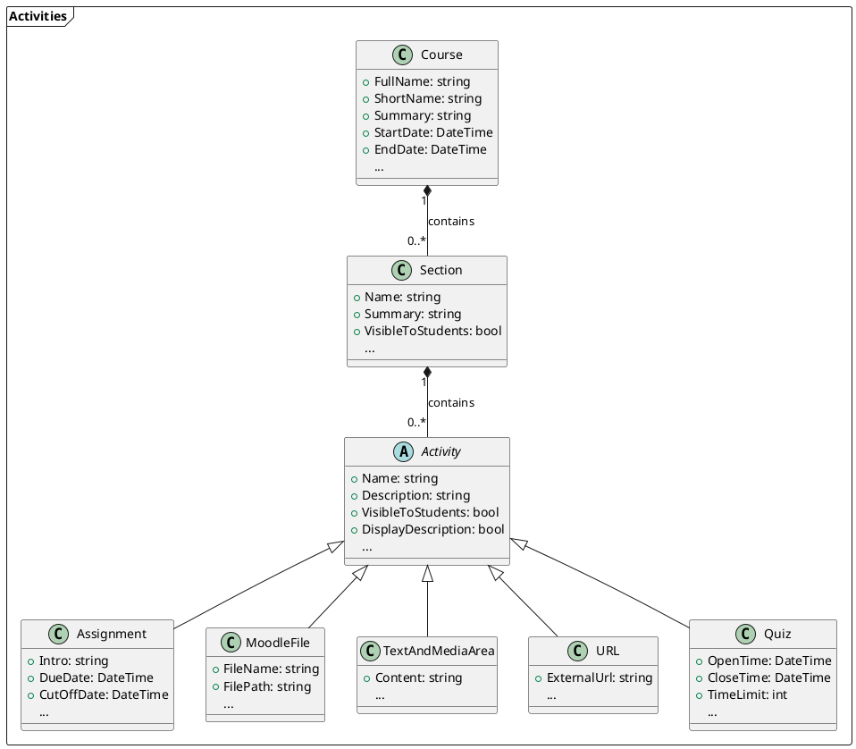

# Activities
A course consists of any number of sections, which in turn can contain any number of activities.

!!! info
    There are certain parameters that are required for all activities. These include, for example, the activity's name and its description, or parameters that determine whether the activity should be visible to students, in which language it should be displayed, etc. These parameters (those that are equally required for all activities) are found in the base class `Activity` - the remaining classes that extend the base class then only contain the parameters relevant to the respective activity.

On the following pages, we explain which activities are supported by **Course as Code** and how they can be used.