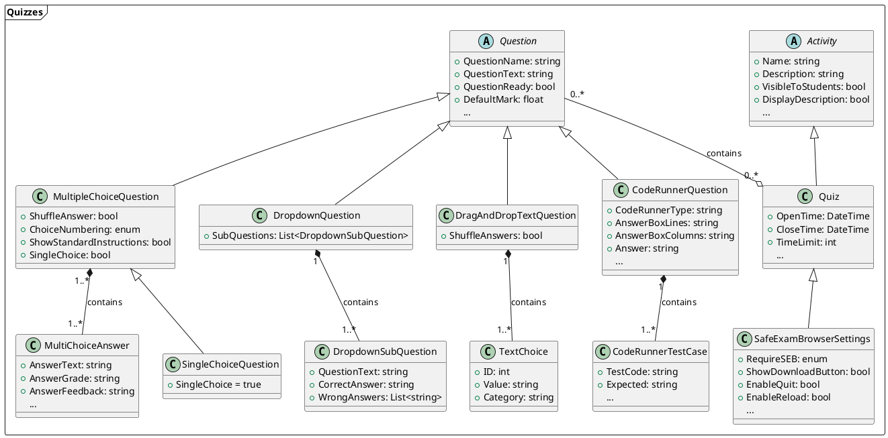
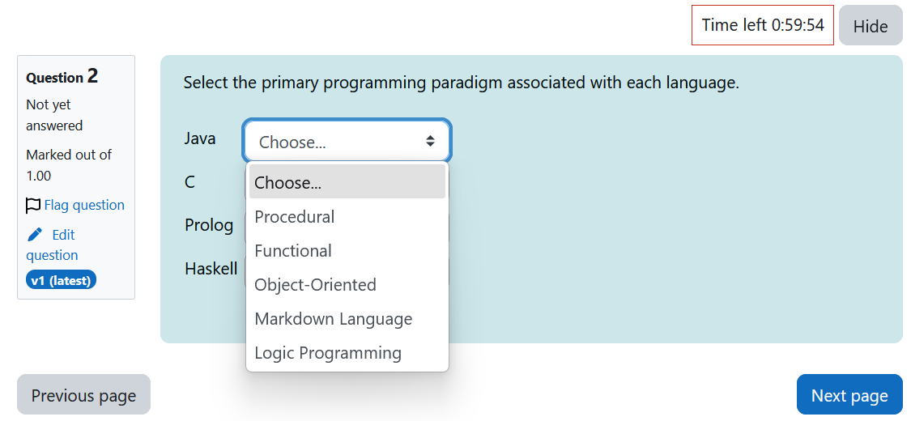
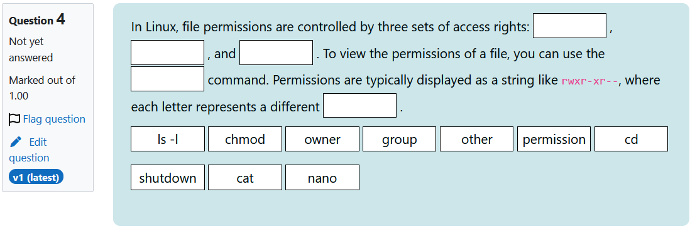
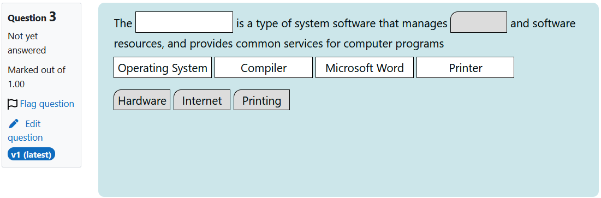

# [Quiz](https://docs.moodle.org/500/en/Quiz_activity)

!!! note
    The [Quiz activity](https://docs.moodle.org/500/en/Quiz_activity) is by far the most extensive activity supported by **Course as Code**, as a quiz can, in turn, contain various question types, all of which require their own structure within the data model. 

As with all other activities discussed so far, the Quiz is also an activity that extends the abstract `Activity` class. A quiz broadly consists of two elements:

- The **Quiz activity itself** and parameters that describe it in more detail (e.g., `OpenTime`, `CloseTime`, `GradeToPass`, `AllowedAttempts`, etc.)
- A series of **questions of various types**

The parameters that define the quiz's metadata are the properties of the `Quiz` class (refer to the **Description Attributes** in the Model class for a precise description of all available parameters).

Furthermore, every quiz is associated with `SafeExamBrowserSettings`. The [Safe Exam Browser (SEB)](https://safeexambrowser.org/about_overview_en.html) is a specialized browser that blocks access to many OS functions and other websites to make cheating more difficult for students. For each quiz, it can be configured whether SEB is required to conduct the quiz and how SEB should be configured for that specific quiz - this information is stored in the `SafeExamBrowserSettings` class.

The core of every quiz are the quiz questions that students must answer. A quiz can contain any number of questions of any type, and a specific question can also appear in multiple quizzes.

### Question Types

!!! info
    There are certain parameters that are required for all question types. These include, for example, their **name** (for internal representation in the QuestionBank), their **text** (i.e., the question itself - all questions have a question statement), or general parameters, such as whether the question is a *draft* or a finished question. These parameters are stored in the abstract parent class `Question`, the subclasses then implement only those parameters that are necessary for that particular type of question.

#### [MultipleChoiceQuestion](https://docs.moodle.org/500/en/Multiple_Choice_question_type)
Multiple Choice Questions are the most common and frequently used type of question in Moodle. They consist of a question statement (`QuestionText` in the base class) and a set of possible answer options (`MultiChoiceAnswer`).

For each `MultiChoiceAnswer`, the `AnswerText` can be defined, along with an `AnswerGrade` that determines the value of that answer.

!!! example
    To create a multiple-choice question with only one correct answer, the `AnswerGrade`s must be set as follows:

    - `Answer Text` = Correct Answer | `AnswerGrade` = 1
    - `Answer Text` = Incorrect Answer | `AnswerGrade` = 0
    - `Answer Text` = Incorrect Answer | `AnswerGrade` = 0

    In this case, the student would receive full marks for selecting the correct answer, but also if they blindly check all answers. To prevent this, a **negative** `AnswerGrade` must be assigned to the incorrect answer options (so that their selection leads to deductions).

    - `Answer Text` = Correct Answer | `AnswerGrade` = 1
    - `Answer Text` = Incorrect Answer | `AnswerGrade` = -1/2
    - `Answer Text` = Incorrect Answer | `AnswerGrade` = -1/2

!!! warning annotate
    It is absolutely necessary that the **positive** `AnswerGrade`s sum up to exactly `1` - otherwise, the question will not be recognized correctly by Moodle. For example, if there are 3 correct and 1 incorrect answer option, this must be defined as follows:

    - `Answer Text` = Correct Answer | `AnswerGrade` = 1/3
    - `Answer Text` = Correct Answer | `AnswerGrade` = 1/3
    - `Answer Text` = Correct Answer | `AnswerGrade` = 1/3
    - `Answer Text` = Incorrect Answer | `AnswerGrade` = -1/3 (1)

    Note that for the positive answers, an `AnswerGrade` in the form of a fraction (`⅓`) was chosen instead of a decimal (e.g., `0.33`). This is absolutely necessary for irrational numbers so that Moodle sums them up correctly. (Internally, the fractions are of course stored by C# as floats and thus again as decimals - however, the precision of a float is sufficient to make it clear to Moodle that it is a fraction.)

1. Negative `AnswerGrade`s do not have to sum up to 1; any value can be chosen.  
**On the contrary**: Negative `AnswerGrade`s can even be values greater than 1, so that the user receives overall point deductions if they answer the question incorrectly.

##### [SingleChoiceQuestion](https://docs.moodle.org/500/en/Multiple_Choice_question_type#Single-answer_questions)
The Single Choice Question is a special form of the Multiple Choice Question, where only one of the given answers is correct (in contrast to Multiple Choice Questions where one **or more** answers can be correct). A question is marked as a Single Choice Question by setting the `SingleChoice` Boolean in the `MultipleChoiceQuestion` class to `true` and setting the `AnswerGrade` parameters accordingly.

!!! info
    If the `AnswerGrade`s are set such that only a single answer is correct, but the `SingleChoice` Boolean is left as `false`, only one answer to the question is correct, but the student can still select multiple answer options. If `SingleChoice` is set to `true`, the student can only select **one** answer when taking the quiz and not multiple.

#### [DropdownQuestion](https://docs.moodle.org/500/en/Matching_question_type)
The Dropdown question is internally referred to as a `Matching Question` in Moodle and, strictly speaking, consists of multiple sub-questions. The `AnswerText` of the parent `Question` class is displayed at the top as a *heading*, while the actual question consists of several sub-questions, namely the assignment of the correct selectable text to the given text.

The `DropdownQuestion` type therefore consists of several `DropdownSubQuestion`s, which represent the individual interaction possibilities for the user (in this case `Java`, `C`, `Prolog`, and `Haskell`). For each sub-question, the `QuestionText` and the `CorrectAnswer` are defined. To make answering the question more challenging, a series of `WrongAnswers` can also be specified.

!!! bug
    The internal data model does not clearly represent how Dropdown Questions (or rather, Matching Questions) function in Moodle.  
    Fundamentally, the question was designed as an assignment task. This means that every correct answer to a sub-question is also available as an answer option for all other sub-questions, but it is only correct for the one where it was specified as the `CorrectAnswer`.

    !!! example
        SubQuestion1: `CorrectAnswer` = "Miami"  
        SubQuestion2: `CorrectAnswer` = "Florida"  
        SubQuestion3: `CorrectAnswer` = "United States"

        Dropdown Menu for SubQuestion1: "Miami, Florida, United States"  
        Dropdown Menu for SubQuestion2: "Miami, Florida, United States"  
        Dropdown Menu for SubQuestion3: "Miami, Florida, United States"

    If additional incorrect answer options are provided, they are also available as answer options for **all** sub-questions, not just for the sub-question where they were listed in the `WrongAnswer` list.

    !!! example
        SubQuestion1: `CorrectAnswer` = "Miami", `WrongAnswer` = "Florida, Kansas"  
        SubQuestion2: `CorrectAnswer` = "Washington", `WrongAnswer` = "Miami, United States"

        Dropdown Menu for SubQuestion1: "Miami, Florida, Kansas, Washington, United States"  
        Dropdown Menu for SubQuestion2: "Miami, Florida, Kansas, Washington, United States"

#### [DragAndDropTextQuestion](https://docs.moodle.org/500/en/Drag_and_drop_into_text_question_type)
The `DragAndDropTextQuestion` format refers to classic fill-in-the-blank questions where the user has to insert the correct word from a set of predefined words into the corresponding gap.

This question type consists of a `QuestionText` (in the parent class `Question`) that can contain gaps, and multiple `TextChoice` elements, each assigned an `ID` and a `Value` (its content), which can be inserted into the cloze text.

The `QuestionText` should be formulated as continuous text. Gaps can be defined using `[[1]]`, where `1` is a sequential number for each gap and references the `ID` field of the `TextChoice` elements. The `TextChoice` element whose `ID` matches the number in the gap placeholder is considered the correct answer for that text position. `TextChoice` elements with an `ID` that is not referenced anywhere in the cloze text are not considered correct answers anywhere and act as distractors.

!!! example
    The question from the example screenshot would be represented in the data model as follows:

    `QuestionText` = "In Linux, file permissions are controlled by three sets of access rights: [[3]], [[4]], and [[5]]. To view the permissions of a file, you can use the [[1]] command. Permissions are typically displayed as a string like `rwxr-xr--`, where each letter represents a different [[6]]."

    `TextChoice` elements:

    - `ID` = 1, `Value` = "ls -l"
    - `ID` = 2, `Value` = "chmod"
    - `ID` = 3, `Value` = "owner"
    - `ID` = 4, `Value` = "group"
    - `ID` = 5, `Value` = "other"
    - `ID` = 6, `Value` = "permission"
    - `ID` = 7, `Value` = "cd"
    - `ID` = 8, `Value` = "shutdown"
    - `ID` = 9, `Value` = "cat"
    - `ID` = 10, `Value` = "nano"

A `TextChoice` can also be assigned to a specific `Category` to specify distractors individually per gap.

!!! example
    The question from the example screenshot would be represented in the data model as follows:

    `QuestionText` = "The [[1]] is a type of system software that manages [[5]] and software resources, and provides common services for computer programs"

    `TextChoice` elements:

    * `ID` = 1, `Value` = "Operating System", `Category` = "A"
    * `ID` = 2, `Value` = "Compiler", `Category` = "A"
    * `ID` = 3, `Value` = "Microsoft Word", `Category` = "A"
    * `ID` = 4, `Value` = "Printer", `Category` = "A"
    * `ID` = 5, `Value` = "Hardware", `Category` = "B"
    * `ID` = 6, `Value` = "Internet", `Category` = "B"
    * `ID` = 7, `Value` = "Printing", `Category` = "B"

#### [CodeRunnerQuestion](https://docs.moodle.org/500/en/CodeRunner_question_type)

!!! warning
    The documentation for CodeRunnerQuestions is currently incomplete and/or incorrect and needs to be revised.