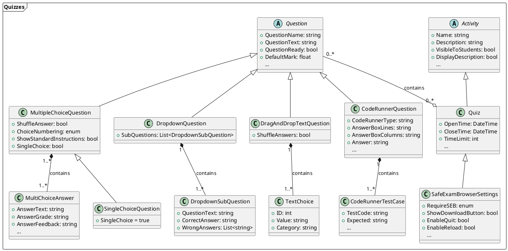

# [Quiz](https://docs.moodle.org/500/en/Quiz_activity)

!!! note
    The [Quiz activity](https://docs.moodle.org/500/en/Quiz_activity) is by far the most extensive activity supported by **Course as Code**, as a quiz can, in turn, contain various question types, all of which require their own structure within the data model. 

As with all other activities discussed so far, the Quiz is also an activity that extends the abstract `Activity` class. A quiz broadly consists of two elements:

- The **Quiz activity itself** and parameters that describe it in more detail (e.g., `OpenTime`, `CloseTime`, `GradeToPass`, `AllowedAttempts`, etc.)
- A series of **questions of various types**

The parameters that define the quiz's metadata are the properties of the `Quiz` class (refer to the **Description Attributes** in the Model class for a precise description of all available parameters).

Furthermore, every quiz is associated with `SafeExamBrowserSettings`. The [Safe Exam Browser (SEB)](https://safeexambrowser.org/about_overview_en.html) is a specialized browser that blocks access to many OS functions and other websites to make cheating more difficult for students. For each quiz, it can be configured whether SEB is required to conduct the quiz and how SEB should be configured for that specific quiz - this information is stored in the `SafeExamBrowserSettings` class.

The core of every quiz are the quiz questions that students must answer. A quiz can contain any number of questions of any type, and a specific question can also appear in multiple quizzes.
