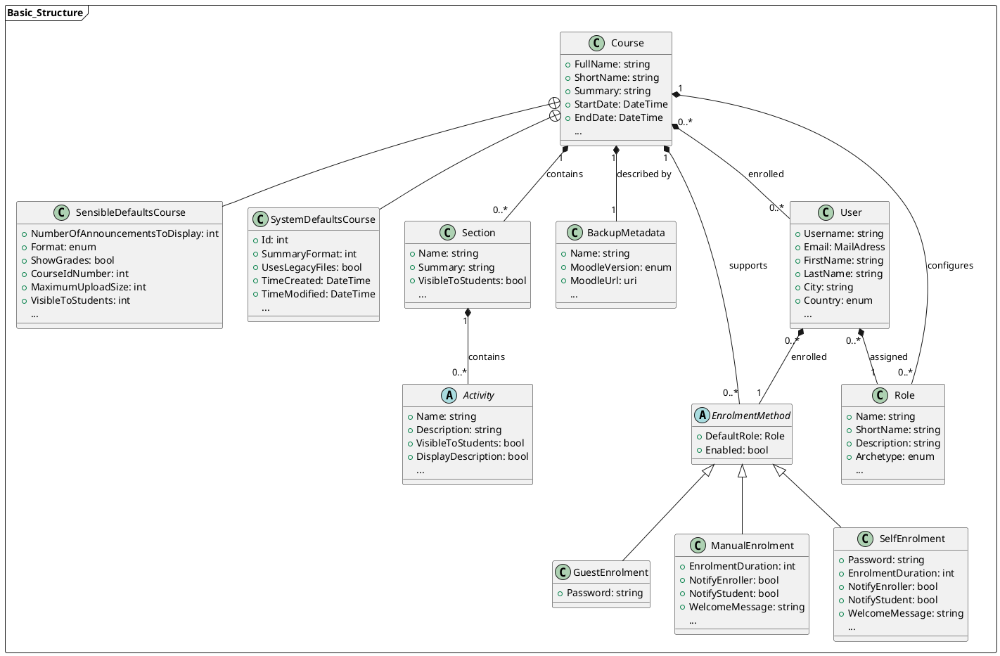
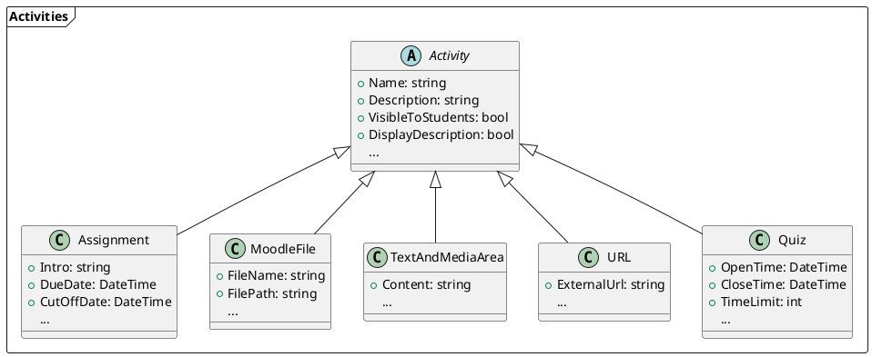
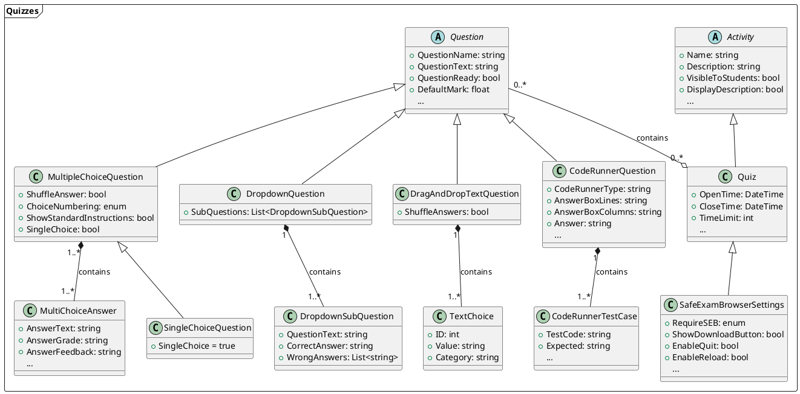

# Data Model
Diese Seite erklärt das interne Datenmodell, das verwendet wird, um die vom Reader ausgelesenen Daten zwischenzuspeichern. Es handelt sich dabei mehr oder weniger um eine alternative (Alternativ zu den Moodle Backup Files) Art und Weise, einen Moodle Kurs samt aller mit ihm assoziierten Parameter zu speichern.

Zur besseren Verständlichkeit teilen wir das Datenmodell nachfolgend in zwei Teilbereiche auf: 

- Zunächst sehen wir uns das Grundgerüst eines Moodle Kurses an - also die grundlegenden Elemente, die einen Kurs ausmachen und beschreiben wie Metadaten, die vorhandenen Sections, enrollte User, etc.
- Im zweiten Schritt sehen wir uns die einzelnen Aktivitäten, die sich in einem Kurs befinden können, genauer an

!!! tip
    Im Quellcode der Modelle ist fast jedes Property mit einem **Description Attribute** ausgestattet, das erklärt, was in diesem Property gespeichert ist und welche Auswirkungen seine Werte auf den Moodle Kurs haben.

    ```csharp
    [Description("if set, the course will be displayed in this language despite the user's preferences")]
	public Language? CourseLanguage { get; set; }
    ```

## Grundstruktur
- Zunächst gibt es einige Datenfelder, die den Moodle Kurs selbst beschreiben und definieren. So hat er beispielsweise einen Namen, einen Kurznamen, ein Beginndatum, ein Enddatum und vieles mehr...
- Da der Moodle Kurs nicht für sich am Dateisystem existiert, sondern nur in Form einer Moodle Backup Datei (`.mbz`) gespeichert und importiert werden kann, müssen auch über diese einige Daten gespeichert werden, wie beispielsweise der Namen der Backup-Datei, die Moodle Version, mit der das Backup erstellt wurde, etc.
- Nutzer, die an einem Kurs teilnehmen (sei es als Student, Lektor oder Administrator), werden als in den Kurs **enrolled** bezeichnet. Über jeden Nutzer, der am Kurs teilnimmt, müssen Informationen wie sein Name, E-Mail Adresse, etc. gespeichert werden
    - Es gibt verschiedene Arten, wie ein Nutzer der Moodle Lernplattform dazu kommt, an einem bestimmten Kurs teilzunehmen. Die Quintessenz ist, dass er dem Kurs irgendwie hinzugefügt werden muss und die Art und Weise wie das geschieht bezeichnet man als **Enrolment Method**. 

        !!! example
            - `Manual Enrolment` bedeutet, dass ein Administrator (oder eine andere berechtigte Person) eine Person manuell zum Kurs hinzugefügt hat  
            - `Self Enrolment` ermöglicht es Personen, sich selbst zu dem Kurs hinzuzufügen (ggf. unter Eingabe eines Passworts)  
            - `Guest Enrolment` ist eine spezielle Teilnahmeform, bei der ein Kursteilnehmer die Kursinhalte zwar einsehen, aber nicht an Aktivitäten teilnehmen kann  

    - Enrolment Methods sind sowohl mit Usern als auch mit dem Kurs assoziiert. Ein Kurs unterstützt bestimmte Enrolment Methods (er erlaubt bspw. Self Enrolments oder nicht) und für einen User wird die Enrolment Method gespeichert, über die er dem Kurs hinzugefügt wurde
    - Zudem ist jedem Nutzer auch eine Rolle zugeordnet, die festlegt, über welche Rechte er verfügt
    
        !!! example
            Beispiele für Rollen wären z.B. `Student`, `Lektor`, `Administrator`, ...

- Abseits dieser Metainformationen ist der Aufbau eines Moodle Kurses im Grunde sehr simpel: Er besteht aus mehreren Sections, die wiederum eine beliebige Anzahl von verschiedenen Aktivitäten enthalten können (werden im nächsten Abschnitt genauer beleuchtet).

### UML-Diagramm



Dieses Klassendiagramm zeigt die oben erklärte Grundstruktur eines Moodle Kurses in visueller Form. Zur besseren Verständlichkeit wurden folgende Vereinfachungen für dieses Klassendiagramm durchgeführt:

- Es sind nicht immer alle Properties per Klasse angeführt: Enthält eine Klasse, neben den hier aufgelisteten Properties, noch weitere, ist das durch 3 Punkte "..." am unteren Ende der Auflistung der Properties gekennzeichnet
- Dieses Klassendiagramm zeigt die Subklassen `SensibleDefaults` und `SystemDefaults` nur für die `Course`-Klasse. Moodle speichert über viele Entitäten zahlreiche Parameter ab: Von diversen internen IDs bis hin zu extrem spezifischen Konfigurationsmöglichkeiten, die unter normalen Umständen nicht benötigt werden. Um die Model-Klassen schlanker zu gestalten, haben wir diese Properties stets in Subklassen ausgelagert. 
    - `SensibleDefaults` enthält dabei Parameter, für die in den meisten Fällen ein Default-Wert genommen werden kann, bei denen es aber grundsätzlich denkbar ist, dass sie der Nutzer unter bestimmten Umständen modifizieren möchte
    - `SystemDefaults` enthält Parameter, für die so gut wie immer ein Default-Wert herangezogen werden kann, da es höchst unwahrscheinlich ist, dass sie der Nutzer modifzieren möchte

!!! info

    Die Subklassen `SensibleDefaults` und `SystemDefaults` existieren für fast alle Klassen, werden - wie oben erwähnt - in diesem Klassendiagramm allerdings nur für die `Course` Klasse beispielhaft visualisiert, um das Klassendiagramm nicht zu überladen

## Aktivitäten
Eine Kurs besteht aus beliebig vielen Sektionen, die wiederum beliebig viele Aktivitäten beinhalten können. Nachfolgend erklären wir, wie die von **Course as Code** unterstützten Aktivitäten im Datenmodell gespeichert werden:

!!! info
    Es gibt bestimmte Paramter, die für alle Aktivitäten benötigt werden. Dazu gehören beispielsweise der Name der Aktivität und ihre Beschreibung oder aber auch Parameter, die festlegen ob die Aktivität für Studenten sichtbar sein soll, in welcher Sprache sie angezeigt werden soll, etc.  
    Diese Parameter (jene, die für alle Aktivitäten gleichermaßen benötigt werden) finden sich in der Basis-Klasse `Activity` - die restlichen Klassen, die die Basisklasse erweitern enthalten dann nur noch jene Parameter, die für die jeweilige Aktivität relevant sind.



### [Assignment](https://docs.moodle.org/500/en/Assignment_activity)
Bei Assignments handelt es sich um eine Moodle Aktivität, die es Studierenden ermöglicht, Dateien beliebigen Dateityps (kann vom Lektor eingeschränkt werden) für die Bewertung abzugeben. 

!!! warning
    Die Dokumentation zu Assignments ist aktuell unvollständig und/oder fehlerhaft und muss überarbeitet werden.

### [Moodle File](https://docs.moodle.org/500/en/File_resource)
Bei der Datei-Aktivität handelt es sich um eine Datei (beliebigen Typs), die vom Kursadministrator (nicht vom Studenten!) hochgeladen wurde und den Studierenden als Lernmaterial zur Verfügung steht. 

!!! info
    Diese Aktivität ist im Grunde nur die Hülle, die die Datei anzeigt. Das eigentlich komplexe ist es, die Datei ins Moodle Backup zu integrieren und sie an korrekter Stelle zu referenzieren. Siehe dazu die explizite Dokumentation über Datei Handling! **TODO: Hyperlink**

Da es sich um eine äußerst einfache Aktivität handelt, sind nur wenige Parameter notwendig, um eine Datei in Moodle einzubinden:

- der Name der Datei `FileName`
- der Pfad zur Datei `FilePath`
- der Autor der Datei `Author` (_optional_)
- die Lizenz der Datei `License` (_optional_)

### [Text And Media Area](https://docs.moodle.org/500/en/Text_and_media_area)
Die Text and Media Area (ehemals: Label) kann dazu verwendet werden, formatierte Inhalte (Text, Fotos, Multimedia, Code, etc.) in den Moodle Kurs einzubinden, womit toll aussehende Sections entworfen werden können. Die Inhalte können als `HTML`, `PlainText` oder `Markdown` formattiert werden.

Zur Definition einer Text and Media Area ist daher nur der abzubildende Content in Form eines _strings_ `Content` und das Format, in dem der Content bereitgestellt wird `FormattingFormat` notwendig.

!!! info
    Bei `FormattingFormat` handelt es sich um ein **enum**, das die Werte `HTML`, `PlainText`, `Markdown` und `MoodleAutoFormat` annehmen kann


### [URL](https://docs.moodle.org/500/en/URL_resource)
Die URL Aktivität referenziert auf eine externe Resource, die außerhalb des Moodle Kurses abgespeichert ist. In ihrem Fall ist nur die Angabe des externen Links `ExternalUrl` notwendig.

<hr>

!!! note
    Die [Quiz Aktivität](https://docs.moodle.org/500/en/Quiz_activity) ist die mit Abstand umfangreichste Aktivität, die von **Course as Code** unterstützt wird, da ein Quiz wiederum verschiedenste Fragetypen beinhalten kann, die alle einer eigenen Struktur im Datenmodell benötigen. Zur besseren Übersicht wurde ihr daher ein eigener Abschnitt in dieser Dokumentation gewidmet.

## [Quiz](https://docs.moodle.org/500/en/Quiz_activity)



Wie bei allen anderen bisher behandelten Aktivitäten handelt es sich auch beim Quiz um eine Aktivität, die die abstrakte `Activity` Klasse erweitert. Ein Quiz besteht grob aus 2 Elementen:

- Der Quiz Aktivität selbst und Parametern, die diese genauer beschreiben (bspw. `OpenTime`, `CloseTime`, `GradeToPass`, `AllowedAttempts`, etc.)
- einer Reihe von Fragen verschiedenen Typs

Die Parameter, die die Metadaten des Quizzes festlegen, sind die Properties der `Quiz` Klasse (siehe die **Description Attributes** in der Model Klasse für eine genaue Beschreibung aller verfügbaren Parameter).

Zudem ist jedes Quiz mit `SafeExamBrowserSettings` assoziiert. Der [Safe Exam Browser (kurz SEB)](https://safeexambrowser.org/about_overview_en.html) ist ein spezieller Browser, der den Zugriff auf viele OS-Funktionen sowie auf andere Websiten blockiert, um Studierenden das Schummeln zu erschweren. Pro Quiz kann eingestellt werden, ob SEB benötigt wird, um das Quiz durchzuführen und wie der SEB für dieses Quiz konfiguriert werden soll - die Informationen dafür werden in der `SafeExamBrowserSettings` Klasse gespeichert.

Herzstück jeden Quizzes sind die Quizfragen, die von den Studenten beantwortet werden müssen. Ein Quiz kann beliebig viele Fragen beliebiger Typen enthalten, wobei eine Frage auch in mehreren Quizzes vorkommen kann.

### Fragetypen

!!! info
    Es gibt bestimmte Parameter, die für alle Fragetypen benötigt werden. Dazu gehören beispielsweise ihr Name (für die interne Darstellung in der QuestionBank), ihr Text (i.e. die Fragestellung - alle Fragen haben eine Fragestellung), oder generelle Parameter, wie bspw. die Angabe, ob es sich bei der Frage um einen _Draft_ oder eine fertige Frage handelt.  
    Die Subklassen implementieren dann jeweils nur jene Parameter, die für diese besondere Art von Frage notwendig sind

#### [MultipleChoiceQuestion](https://docs.moodle.org/500/en/Multiple_Choice_question_type)
Multiple Choice Fragen sind die üblichste und am häufigsten verwendete Art von Fragen in Moodle. Sie bestehen aus einer Fragestellung `QuestionText` (in der Basisklasse) und einer Reihe von möglichen Antwortmöglichkeiten `MultiChoiceAnswer`. 

Für jede `MultiChoiceAnswer` kann der `AnswerText` festgelegt werden und ein `AnswerGrade`, das den Wert dieser Antwort festlegt. 

!!! example 
    Um beispielsweise eine Multiple Choice Frage mit nur einer richtigen Antwort zu erstellen, müssen die `AnswerGrade`s folgendermaßen gesetzt werden:

    - Korrekte Antwort | `AnswerGrade = 1`
    - Falsche Antwort | `AnswerGrade = 0`
    - Falsche Antwort | `AnswerGrade = 0`

    In diesem Fall würde der Student für das Ankreuzen der richtigen Antwort, die volle Punktzahl auf diese Frage bekommen - jedoch auch, wenn er blind einfach alle Fragen ankreuzt. Um dies zu verhindern, muss den falschen Antwortmöglichkeiten, ein **negativer** `AnswerGrade´ zugewiesen werden (sodass deren Auswahl zu Punktabzügen führt) 

    - Korrekte Antwort | `AnswerGrade = 1`
    - Falsche Antwort | `AnswerGrade = -1/2`
    - Falsche Antwort | `AnswerGrade = -1/2`

!!! warning annotate 
    Es ist zwingend notwendig, dass sich die **positiven** `AnswerGrade`s auf exakt `1` aufsummieren - ansonsten wird die Frage von Moodle nicht korrekt erkannt. Gibt es also beispielsweise 3 richtige und 1 falsche Antwortmöglichkeit, muss dies folgendermaßen definiert werden:

    - Korrekte Antwort | `AnswerGrade = 1/3`
    - Korrekte Antwort | `AnswerGrade = 1/3`
    - Korrekte Antwort | `AnswerGrade = 1/3`
    - Falsche Antwort | `AnswerGrade = -1/3` (1)

    Beachten Sie, dass für die positiven Antworten ein `AnswerGrade` in Form eines Bruchs gewählt wurde (`⅓`) statt einer Dezimalzahl (z.B. `0,33`). Dies ist bei irrationalen Zahlen zwingend notwendig, damit Moodle die Summen korrekt aufaddiert. (intern werden die Brüche natürlich von C# als floats und somit wieder als Dezimalzahl abgespeichert - die Genauigkeit eines floats ist jedoch ausreichend, um Moodle klarzumachen, dass es sich um einen Bruch handelt)

1. Negative `AnswerGrade`s müssen sich nicht auf 1 aufsummieren, es kann daher ein beliebiger Wert gewählt werden.  
**Im Gegenteil**: Negative `AnswerGrade`s können sogar Werte über 1 annehmen, sodass der Nutzer Punkteabzüge erhält, wenn er die Frage falsch beantwortet.


##### [SingleChoiceQuestion](https://docs.moodle.org/500/en/Multiple_Choice_question_type#Single-answer_questions)
Bei der Single Choice Frage handelt es sich um eine Sonderform der Multiple Choice Frage, bei der nur eine der gegebenen Antworten korrekt ist (Vergleich: Bei der Multiple Choice Frage sind eine **oder mehrere** Antworten korrekt). Eine Frage wird als Single Choice Frage markiert, indem das Boolean `SingleChoice` der `MultipleChoiceQuestion` Klasse auf true gesetzt wird und die `AnswerGrade` Parameter entsprechend gesetzt werden.

!!! info
    Werden die `AnswerGrade`s so gesetzt, dass nur eine einzelne Antwort richtig ist, das Boolean `SingleChoice` jedoch auf `false` belassen, ist nur eine Antwort der Frage richtig, es können vom Studenten jedoch auch mehrere Antwortmöglichkeiten ausgewählt werden. Wird `SingleChoice` auf `true` gesetzt, kann der Student beim Bearbeiten des Quizzes nur **eine** Antwort auswählen und nicht mehrere.

#### [DropdownQuestion](https://docs.moodle.org/500/en/Matching_question_type)
Die Dropdown Frage wird intern in Moodle als `Matching Question` bezeichnet und besteht streng genommen aus mehreren Unterfragen. Der `AnswerText` der Vater-Klasse `Question` wird oben als _Überschrift_ angezeigt, die eigentliche Frage hingegen besteht aus mehreren Unterfragen, nämlich der Zuordnung des korrekten auswählbaren Texts zum vorgegebenen Text.


Der `DropdownQuestion` Typ besteht daher aus mehreren `DropdownSubQuestion`s, die die einzelnen Interaktionsmöglichkeiten für den Nutzer repräsentieren (in diesem Fall `Java`, `C`, `Prolog` und `Haskell`). Für jede Subfrage wird der `QuestionText` sowie die `CorrectAnswer` festgelegt. Um die Beantwortung der Frage schwieriger zu gestalten, kann zudem eine Reihe von `WrongAnswers` zusätzlich angegeben werden.

!!! bug
    Das interne Datenmodell repräsentiert hier nicht eindeutig die Art und Weise, wie Dropdown Questions (bzw. eigentlich Matching Questions) in Moodle funktionieren.  
    Grundsätzlich ist es so, dass die Frage als Zuordnungsaufgabe entworfen wurde. Das bedeutet, dass jede richtige Antwort einer Subfrage auch als Antwortmöglichkeit bei allen anderen Subfragen zur Verfügung steht, aber eben nur bei einer richtig ist (derjenigen, bei der sie als `CorrectAnswer` angegeben wurde).  

    !!! example  
        SubQuestion1: `CorrectAnswer` = "Miami"   
        SubQuestion2: `CorrectAnswer` = "Florida"   
        SubQuestion3: `CorrectAnswer` = "United States" 
          
        Dropdown Menu for SubQuestion1: Miami, Florida, United States  
        Dropdown Menu for SubQuestion2: Miami, Florida, United States  
        Dropdown Menu for SubQuestion3: Miami, Florida, United States

    Werden zusätzlich noch falsche Antwortmöglichkeiten angegeben, stehen diese ebenfalls bei **allen** und nicht nur bei der Subfrage, bei der sie in der `WrongAnswer` Liste angegeben wurden, als Antwortmöglichkeit zur Verfügung.

    !!! example  
        SubQuestion1: `CorrectAnswer` = "Miami", `WrongAnswer` = "Florida, Kansas"  
        SubQuestion2: `CorrectAnswer` = "Washington", `WrongAnswer` = "Miami, United States"  
      
        Dropdown Menu for SubQuestion1: Miami, Florida, Kansas, Washington, United States  
        Dropdown Menu for SubQuestion2: Miami, Florida, Kansas, Washington, United States 

#### [DragAndDropTextQuestion](https://docs.moodle.org/500/en/Drag_and_drop_into_text_question_type)
Beim `DragAndDropTextQuestion` Format handelt es sich um klassische Lückentext-Fragen, bei der der Nutzer aus einer Reihe von vordefinierten Wörtern das korrekte in die entsprechende Lücke einsetzten muss.


Dieser Fragentyp besteht aus einem `QuestionText` (in der Vater-Klasse `Question`), der Lücken enthalten kann und mehreren `TextChoice` Elementen, denen jeweils eine `ID` und eine `Value` (= ihr Inhalt) zugeordnet ist, die in den Lückentext eingesetzte werden können.

Der `QuestionText` sollte als Fließtext formuliert werden, Lücken können mithilfe von `[[1]]` definiert werden, wobei `1` eine für jede Lücke aufsteigende Zahl ist und auf das `ID` Feld der `TextChoice` Elemente referenziert. Das `TextChoice` Element, dessen `ID` der Zahl im Lückentext-Platzhalter entspricht, gilt als korrekte Antwort für diese Textstelle. `TextChoice` Elemente mit einer `ID`, die nirgends im Lückentext refernziert werden, geleten nirgends als korrekte Antwort und gelten als Distraktoren.

!!! example
    Die Frage aus dem Beispiel-Screenshot würde im Datenmodell folgendermaßen dargestellt werden:

    `QuestionText` = "In Linux, file permissions are controlled by three sets of access rights: [[3]], [[4]], and [[5]]. To view the permissions of a file, you can use the [[1]] command. Permissions are typically displayed as a string like `rwxr-xr--`, where each letter represents a different [[6]]."  

    `TextChoice` Elemente:

    - `ID` = 1, `Value` = "ls -l"
    - `ID` = 2, `Value` = "chmod"
    - `ID` = 3, `Value` = "owner"
    - `ID` = 4, `Value` = "group"
    - `ID` = 5, `Value` = "other"
    - `ID` = 6, `Value` = "permission"
    - `ID` = 7, `Value` = "cd"
    - `ID` = 8, `Value` = "shutdown"
    - `ID` = 9, `Value` = "cat"
    - `ID` = 10, `Value` = "nano"

Eine `TextChoice` kann zudem einer bestimmten `Category` zugeordnet werden, um die Distraktoren pro Lücke individuell anzugeben.


!!! example
    Die Frage aus dem Beispiel-Screenshot würde im Datenmodell folgendermaßen dargestellt werden:

    `QuestionText` = "The [[1]] is a type of system software that manages [[5]] and software resources, and provides common services for computer programs"  

    `TextChoice` Elemente:

    - `ID` = 1, `Value` = "Operating System", `Category` = "A"
    - `ID` = 2, `Value` = "Compiler", `Category` = "A"
    - `ID` = 3, `Value` = "Microsoft Word", `Category` = "A"
    - `ID` = 4, `Value` = "Printer", `Category` = "A"
    - `ID` = 5, `Value` = "Hardware", `Category` = "B"
    - `ID` = 6, `Value` = "Internet", `Category` = "B"
    - `ID` = 7, `Value` = "Printing", `Category` = "B"

#### [CodeRunnerQuestion](https://docs.moodle.org/500/en/CodeRunner_question_type)

!!! warning
    Die Dokumentation zu CodeRunnerQuestions ist aktuell unvollständig und/oder fehlerhaft und muss überarbeitet werden.