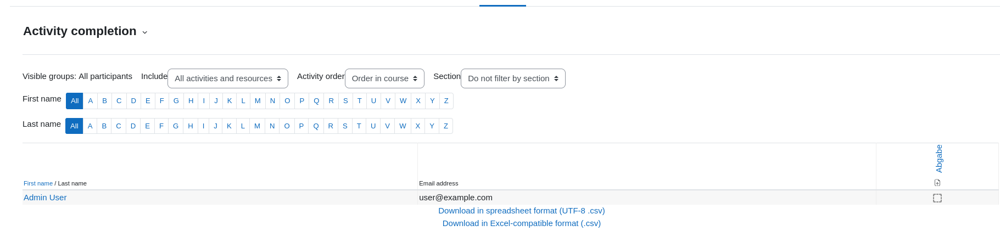
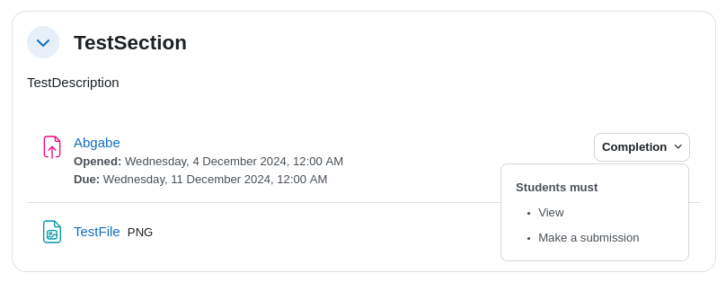
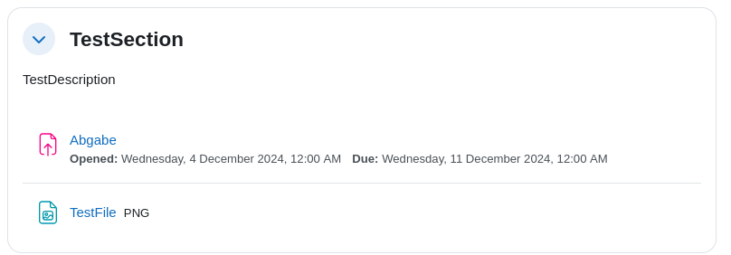

# Course-specific Nomenclature
The basic information about a Moodle course is stored in `CourseAsCode.Model/Course.cs`. Here as well, an attempt has been made to explain most properties clearly using Data Annotations. However, some properties, especially those defined with enums, may be more difficult to understand. The following documentation explains some of these more complex terms:

## CourseFormat
The course format refers to the layout of a course. 

| Value in Data Model   | Value in Moodle XML | Description                                                |
|-----------------------|---------------------|------------------------------------------------------------|
| CustomSections        | topics              | course is divided into customisable sections               |
| WeeklySections        | weeks               | course is divided into sections corresponding to each week |
| SingleActivity        | singleactivity      | course contains only one activity or resource              |
| Social                | social              | course is centred around a main forum on the course page   |

See [moodle docs](https://docs.moodle.org/405/en/Course_formats) for more information

## NumberOfAnnouncementsToDisplay  
The Announcements forum is a special forum for general news and announcements. By default, it is placed at the top of the course and only teachers and users with appropriate permissions (by default teachers) can post in it.  The forum has forced subscription set by default.  

The [latest announcements block](https://docs.moodle.org/405/en/Latest_announcements_block) displays a specific number of recent discussions from the Announcements forum. 

| Value in Data Model | Value in Moodle XML | Description                                                                       |
|---------------------|---------------------|-----------------------------------------------------------------------------------|
| 0                   | 0                   | disables the announcements forum                                                  |
| 1                   | 1                   | only the most recent announcement is displayed in the latest announcements block  |
| 2                   | 2                   | the two most recent announcements are displayed in the latest announcements block |
| ...                 | ...                 | ...                                                                               |

The default value for this field is `3`.  

See [moodle docs](https://docs.moodle.org/405/en/Announcements_forum) for more information

## CourseIdNumber  
Warning: Not to be confused with the `Id` field!

The ID number can be used to match this course against an external system's ID, as a course catalogue ID or in the certificate module as a printed field.  
Unlike the `Id` field, the `CourseIdNumber` is optional.

See [moodle docs](https://docs.moodle.org/405/en/Course_settings#Course_ID_number) for more information

## MaximumUploadSize  
The default maximum upload size for student submissions for all activities in this course  
Can still be modified manually for each activity.

Values need to be specified in bytes. Use [MB to Bytes Conversion](https://www.gbmb.org/mb-to-bytes) and [KB to Bytes Conversion](https://www.gbmb.org/kb-to-bytes).

| Value in Data Model | Value in Moodle XML | Description                                            |
|---------------------|---------------------|--------------------------------------------------------|
| 0                   | 0                   | no limit -> maximum upload size supported by webserver |
| 20971520            | 20971520            | Upload size limit of 20 MB                             |
| 512000              | 512000              | Upload size limit of 500 KB                            |
| ...                 | ...                 | ...                                                    |

See [moodle docs](https://docs.moodle.org/405/en/File_upload_size) for more information

## Theme  
A single moodle course can use a different theme than the default theme of the whole moodle site (has to be enabled in administrator settings). If the course should use a custom theme, it should be specified here.

The value must match the name of a theme in the Moodle installation, see [moodle docs](https://moodledev.io/docs/4.4/apis/plugintypes/theme#getting-your-theme-to-appear-correctly-in-theme-selector)  

| Value in Data Model | Value in Moodle XML | Description                                                                                                            |
|---------------------|---------------------|------------------------------------------------------------------------------------------------------------------------|
| moove               | moove               | course uses the [moove theme](https://moodle.org/plugins/theme_moove) (even if the moodle site uses a different theme) |
| ...                 | ...                 | ...                                                                                                                    |

## EnableCompletionTracking
If enabled, the completion status for each activity can be tracked by teachers and students  
See [moodle docs](https://docs.moodle.org/405/en/Tracking_progress) for more information

## ShowActivityCompletionConditions  
If enabled, the teacher can set and students will be able to see a list of what they must do to complete an activity  
The more precise configuration of this feature takes place at the activity level.

See [moodle docs #1](https://docs.moodle.org/405/en/Activity_completion) and [moodle docs #2](https://docs.moodle.org/405/en/Activity_completion_settings)  

### UsesLegacyFiles  
Moodle uses a "new" file system since version 2.0. This setting tells Moodle if this backup uses the new or old file system

| Value in Data Model | Value in Moodle XML | Description                                       |
|---------------------|---------------------|---------------------------------------------------|
| false               | 0                   | backup uses the new file system (no legacy files) |
| true                | 1                   | backup uses the old file system                   |

See [moodle docs](https://docs.moodle.org/405/en/Legacy_course_files) for more information

### CourseLanguage  
By default, Moodle detects a user's language from their browser setting and displays the course in the corresponding language.  
Using this setting, the teacher can force the course to use a specific language setting  

| Value in Data Model | Value in Moodle XML | Description                                      |
|---------------------|---------------------|--------------------------------------------------|
| `Null`              | ` `                 | don't force a language                           |
| English             | en                  | force the course page to be displayed in English |

### CategoryName  
Course categories are used to organize courses into descriptive categories, making them easier to find for teachers and students. The default course category on a new Moodle site is `Category 1`.  
A course can (and must) only be in one category at a time.

See [moodle docs](https://docs.moodle.org/405/en/Course_categories) for more information

### CustomFields
Custom fields can be used to create field types to be used for custom fields. Instances of these field types can be added to the respective areas that implement Custom fields API.  

See [moodle docs](https://moodledev.io/docs/4.4/apis/plugintypes/customfield) for more information

| Value in Data Model | Value in Moodle XML | Description                           |
|---------------------|---------------------|---------------------------------------|
| `Null`              | ` `                 | Course does not use any custom fields |
| TBD                 | TBD                 | TBD                                   |

### PdfExportFont
Used to specify a custom font for PDF Exports. Only relevant for languages with non-latin scripts (e.g. Arabic, Chinese, Japanese, Korean, etc.) to ensure that the text is displayed correctly in the PDF.

See [moodle docs](https://docs.moodle.org/405/en/Language_settings#Enable_PDF_fonts) for more information