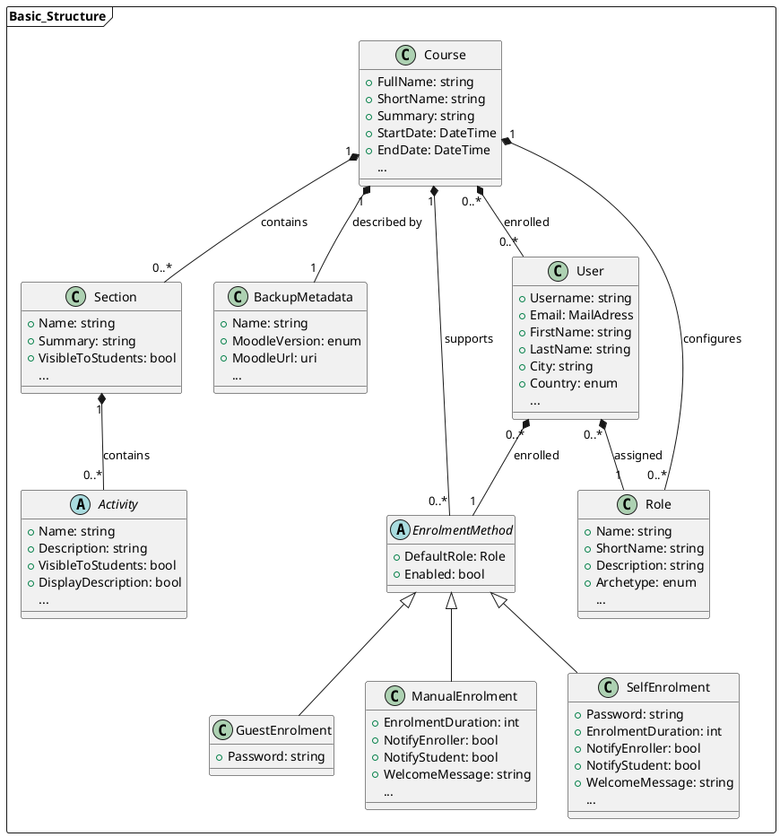
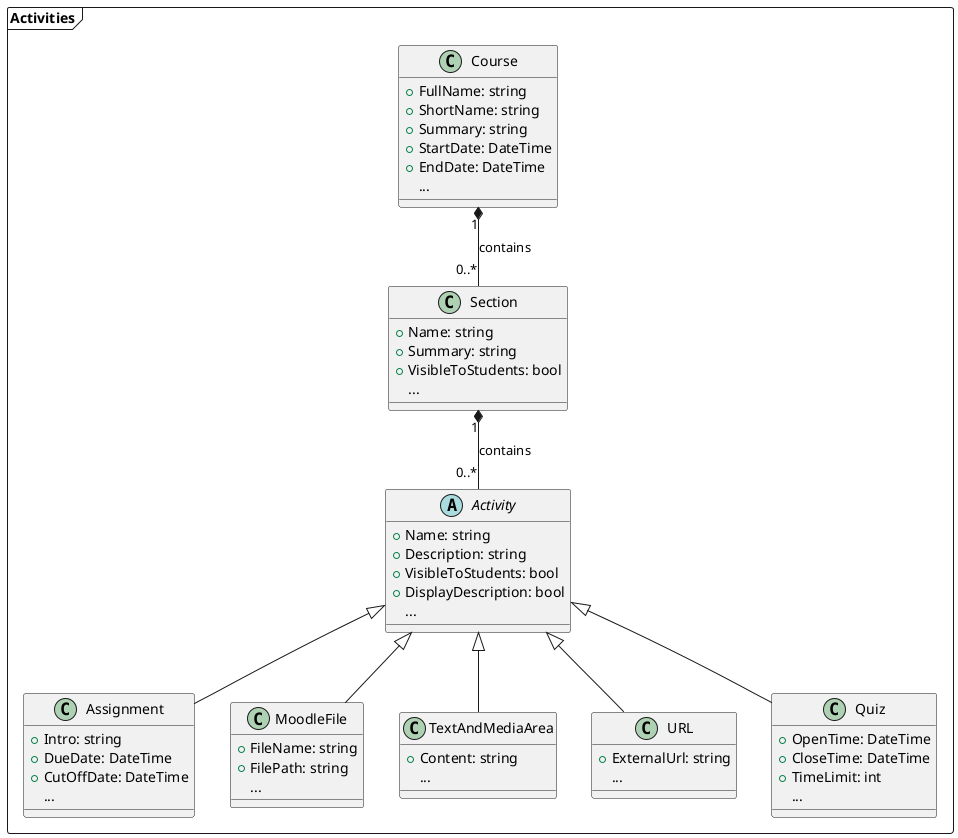

# Data Model
This page explains the **internal data model** used to store the data read by the [Reader](../Readers.md). It is essentially an alternative way (alternative to [Moodle backup files](../../MoodleBackupFile/General.md) to save a Moodle course, along with all its associated parameters.

We will explain the basic structure of a Moodle course in the internal data model - that is, the fundamental elements that make up a course, such as metadata, sections, enrolled users, etc.  
For information on how the individual activities are implemented, see [Activities](../../Activities/index.md)!

!!! tip
    Almost every property in the source code of the models has a **Description Attribute** that explains what is stored in the property and how its values affect the Moodle course.

    !!! example

        ```csharp
        [Description("if set, the course will be displayed in this language despite the user's preferences")]
        public Language? CourseLanguage { get; set; }
        ```

## Basic Structure
<div class="annotate" markdown>
- First off, there are several data fields that describe and define the Moodle course itself. For instance, it has a **name**, a **short name**, a **start date**, an **end date**, and much more (1)
- Since a Moodle course doesn't exist independently on the file system but can only be saved and imported as a Moodle Backup file (`.mbz`), some data about this backup file also needs to be stored, such as the **backup file's name**, the **Moodle version** it was created with, and so on. (2)
- Users who participate in a course (whether as a student, lecturer, or administrator) are referred to as **enrolled** in the course. Information about each user participating in the course, such as their **name**, **email address**, etc., must be stored. (3)
    - There are various ways a user on the Moodle learning platform can participate in a specific course. The main idea is that they must be added to the course somehow, and the way this happens is called the **Enrolment Method**. (4)

        !!! example
            - `Manual Enrolment` means an administrator (or another authorized person) manually adds a person to the course.
            - `Self Enrolment` allows individuals to add themselves to the course (possibly by entering a password).
            - `Guest Enrolment` is a special form of participation where a course participant can view course content but cannot participate in activities.

    - Enrolment Methods are associated with both **users** and the **course**. A course supports certain Enrolment Methods (e.g., it allows or disallows self-enrolments), and for each user, the Enrolment Method through which they were added to the course is stored.
    - Additionally, each user is assigned a **role** that determines their permissions. (5)

        !!! example
            Examples of roles include [`Student`](https://docs.moodle.org/500/en/Student_role), [`Teacher`](https://docs.moodle.org/500/en/Teacher_role), [`Administrator`](https://docs.moodle.org/500/en/Site_administrators), etc.

- Aside from this meta-information, the structure of a Moodle course is quite simple:  
It consists of multiple **Sections**, which in turn can contain any number of different [**activities**](../Activities/index.md).
</div>

1. This basic data is stored in `CourseAsCode.Model/Course.cs`.
2. This metadata is stored in `CourseAsCode.Model/BackupMetadata.cs`.
3. `CourseAsCode.Model/User.cs` contains the data that is stored about a user. Which users are enrolled in a course is stored in the `List<User> EnrolledUsers` property of `CourseAsCode.Model/Course.cs`.
4. Enrolment methods are represented by `CourseAsCode.Model/EnrolmentMethod.cs`. This is an abstract class that contains some parameters required by all enrolment methods. Concrete implementations for the individual enrolment methods can be found in `CourseAsCode.Model/Enrolments/`.
    The `List<EnrolmentMethod> EnrolmentMethods` property in `CourseAsCode.Model/Course.cs` determines which enrolment methods are supported by the course.
5. The information about a specific role is stored in `CourseAsCode.Model/Role.cs`. The `List<Role> Roles` property in `CourseAsCode.Model/Course.cs` determines which roles exist in a course.

### UML Diagram



This class diagram visually represents the basic structure of a Moodle course as explained above. To improve readability, the following simplifications have been made for this class diagram:

* **Not all properties are always listed per class:** If a class contains additional properties beyond those listed here, it's indicated by three dots "..." at the bottom of the property list.
* **This class diagram doesn't show the `SensibleDefaults` and `SystemDefaults` subclasses**. Moodle stores numerous parameters for many entities: from various internal IDs to extremely specific configuration options that aren't typically needed. To make the model classes leaner, we've moved these properties into subclasses.
    * `SensibleDefaults` contains parameters for which a default value can be used in most cases, but where it's generally conceivable that a user might want to modify them under certain circumstances.
    * `SystemDefaults` contains parameters for which a default value can almost always be used, as it's highly unlikely that a user would want to modify them.

!!! info
    The `SensibleDefaults` and `SystemDefaults` subclasses currently exist for almost all classes. However, we are in the process of dismantling this structure and will instead store all properties directly in the class. We have found that this architectural decision is more detrimental than helpful, as you can never know from memory if a particular property is stored in `SensibleDefaults` or `SystemDefaults`, which leads to a lot of trial and error.  
    In the future, we may use data annotations to mark which properties would fall into the `SensibleDefaults` or `SystemDefaults` categories.

## Activities

A course consists of any number of sections, which in turn can contain any number of activities.



!!! info
    There are certain parameters that are required for all activities. These include, for example, the activity's name and its description, or parameters that determine whether the activity should be visible to students, in which language it should be displayed, etc. These parameters (those that are equally required for all activities) are found in the base class `Activity` - the remaining classes that extend the base class then only contain the parameters relevant to the respective activity.

Understanding the data models of the individual activities is straightforward, as they are just simple classes that store information. As mentioned above, all properties in these classes are also equipped with Data Annotations that explain their functionality.

!!! example

    ```csharp
        [Description("Introduction text for the assignment")]
        public string Intro { get; set; } = AssignmentDefaults.DEFAULT_INTRO;

        [Description("Format of the introduction text (e.g., HTML, PlainText)")]
        public FormattingFormat FormattingFormat { get; set; } = AssignmentDefaults.DEFAULT_FORMATTING_FORMAT;
    ```

For more detailed information on the individual activities, please refer to [activities](../../Activities/index.md).