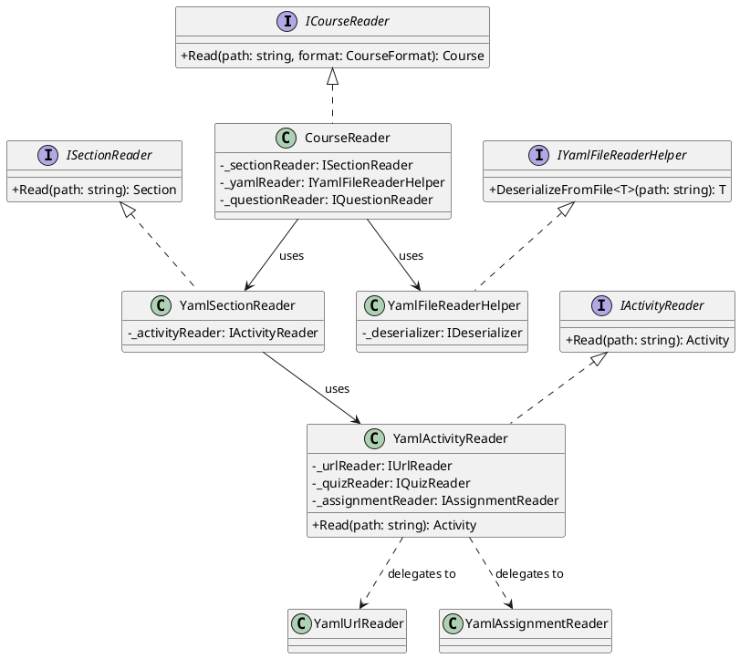

# Readers Architecture

The **Readers** component (`CourseAsCode.Readers`) is responsible for parsing the infrastructure-as-code definitions (YAML files) and transforming them into the internal Domain Model (`CourseAsCode.Model`).

It acts as the bridge between the user-defined configuration on the file system and the object graph used by the Writers to generate the Moodle backup.

## Architectural Overview

The reading process follows a hierarchical **Top-Down** approach, mirroring the structure of a Moodle course:
1.  **Course Reader**: Reads the global configuration and section definitions.
2.  **Section Reader**: Iterates through sections and identifies activities.
3.  **Activity Reader**: Dispatches specific activity files to their specialized readers (e.g., Assignment, Quiz, URL).

### Key Design Patterns

* **DTO (Data Transfer Object) Pattern**: The system uses a strictly separated set of classes for YAML deserialization (`CourseAsCode.Readers.YAML.Model`) versus the internal logic (`CourseAsCode.Model`).
    * *YAML Models*: Represent the exact structure of the input files. They are decorated with `YamlDotNet` attributes.
    * *Domain Models*: Represent the logical structure of a Moodle course, independent of the input format.
* **Factory/Strategy Pattern**: The `YamlActivityReader` acts as a dispatcher. It determines the type of activity defined in a YAML file and delegates the processing to a specific implementation (e.g., `YamlUrlReader`, `YamlAssignmentReader`).
* **Dependency Injection**: All readers are registered in the DI container (via `CourseReader.ConfigureYamlServices`), ensuring modularity and testability.

## Implementation Details

### The Reading Flow

The entry point is `CourseReader.Read(path, format)`.

1.  **Directory Scanning**: The `DirectoryReader` scans the target folder to build a file tree, locating critical files like `config.yaml` and `sections.yaml`.
2.  **Context Initialization**: The `ValueKeeper` static class is initialized. This is used to maintain state across different readers, such as tracking unique IDs for activities and sections or storing global question banks.
3.  **Deserialization**: The `YamlFileReaderHelper` wraps the `YamlDotNet` library. It handles:
    * Validation of required fields.
    * Custom type conversion (e.g., strict date formats).
    * Error handling for malformed YAML.
4.  **Mapping**: Each specific reader (e.g., `YamlSectionReader`) takes the deserialized YAML model and maps it to the corresponding Domain Model object.

### Class Diagram

The following diagram illustrates the relationships between the core interfaces and their YAML implementations.



### Sequence Diagram: Reading a Course
This sequence demonstrates how a `Read` call propagates through the system.

```
@startuml
participant Client
participant "CourseReader" as CR
participant "YamlFileReaderHelper" as YAML
participant "SectionReader" as SR
participant "ActivityReader" as AR
participant "SpecificReader\n(e.g. UrlReader)" as SPR

Client -> CR: Read(path)
activate CR

CR -> YAML: Deserialize "config.yaml"
CR -> YAML: Deserialize "sections.yaml"

loop For each Section in definition
    CR -> SR: Read(sectionPath)
    activate SR
    
    SR -> YAML: Deserialize "section.yaml"
    
    loop For each Activity in Section
        SR -> AR: Read(activityPath)
        activate AR
        
        AR -> YAML: Deserialize (Generic Activity)
        note right: Determines Activity Type
        
        alt Type is URL
            AR -> SPR: Read(activityPath)
            activate SPR
            SPR -> YAML: Deserialize <YamlUrl>
            SPR -> SPR: Map YamlUrl to URL Model
            SPR --> AR: URL Model
            deactivate SPR
        end
        
        AR --> SR: Activity Model
        deactivate AR
    end
    
    SR --> CR: Section Model
    deactivate SR
end

CR -> CR: Finalize Course Object
CR --> Client: Course Model
deactivate CR
@enduml
```

# Developer Guide
## Adding a New Activity Type
To support a new Moodle activity type (e.g., "Workshop"), follow these steps:

1. **Define the Domain Model**: Create `Workshop.cs` in `CourseAsCode.Model/Activities/Resources/`. Inherit from Activity.
2. **Define the YAML Model**: Create `YamlWorkshop.cs` in `CourseAsCode.Readers/YAML/Model/`. This must match the expected YAML structure exactly.
3. **Create the Reader Interface**: Add `IWorkshopReader.cs` in `CourseAsCode.Readers/Interfaces/`.
4. **Implement the Reader**: Create `YamlWorkshopReader.cs` in CourseAsCode.Readers/YAML/Readers/.
    - Inject `IYamlFileReaderHelper`.
    - Implement logic to deserialize `YamlWorkshop` and map it to `Workshop`.
5. **Register Dependency Injection**: Add the new service in `CourseReader.ConfigureYamlServices`:
```C#
services.AddSingleton<IWorkshopReader, YamlWorkshopReader>();
```
6. **Update the Dispatcher**: Modify `YamlActivityReader.cs`:
    - Inject `IWorkshopReader` via the constructor.
    - Add a case to the `switch (yamlActivity.Type)` statement to handle the new type.

## Key Utilities
- **ValueKeeper**: Use this static helper if your reader needs access to global state, such as generating sequential IDs that must be unique across the entire course (`ValueKeeper.CurrentActivityId`).
- **DirectoryReader**: Use this if you need to perform complex file lookups relative to the current course directory structure.