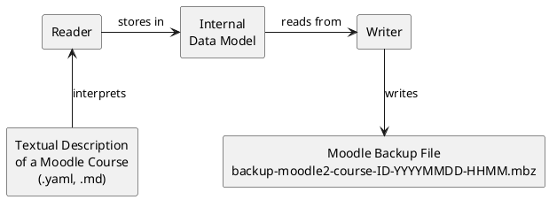

In this section, we explain the basic architecture of **Course As Code**: 

Course as Code is a modular application that, broadly speaking, consists of three main components:

- A Reader component that reads text files and stores the information in an internal data model
- An internal data model that uses classes to represent a Moodle course along with all its supported components
- A Writer component that subsequently writes the information stored in the internal data model into the .xml files required by Moodle

More detailed information on the individual components can be found on the following pages:

* [Readers](./Readers.md)
* [Internal Data Model](./DataModel/index.md)
* [Writer](./Writer.md)