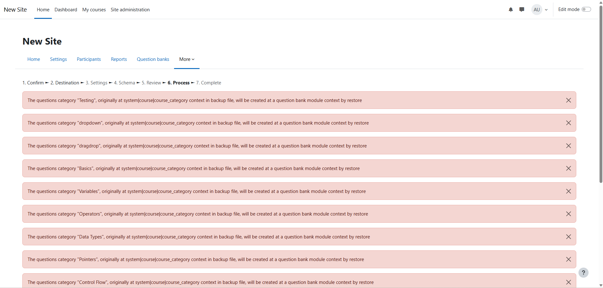
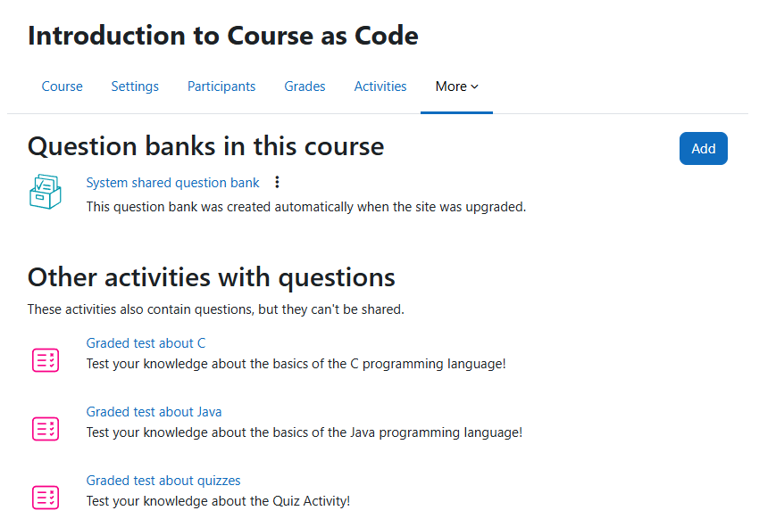

# Error Messages During Course Import in Moodle 5.X
On April 14, 2025, Moodle 5.0 was released, a new major version of Moodle that introduces several breaking changes. One of these concerns how Question Banks are stored internally within Moodle.

!!! info
    Since the development of Course As Code began when Moodle 4.X was the latest version, a Moodle 4.X course is currently being generated by Course As Code.

While in Moodle 4.5 and earlier, questions were stored in a global Question Bank at the course level, since Moodle 5.0, it is possible for a course to have multiple Question Banks. Moodle stores these internally just like other activities (e.g. Quizzes, Links, or Text and Media Areas). Fortunately, Moodle 5.X is backward compatible with earlier Moodle versions and automatically migrates the Question Bank to the new format when importing a course created for Moodle 4.X or earlier versions.

However, to alert the user to the migration taking place and to inform them where the questions are now stored in the new architecture, Moodle 5.X displays some relatively ominous-looking warning messages during the course import:

These warning messages can simply be dismissed or skipped by clicking the "Continue" button. They are not errors, but merely somewhat poorly designed information messages from Moodle indicating that a migration of the Question Bank to the new Moodle 5.0 format has taken place:

!!! Success
    The course has no functional limitations after the import and is from now on treated by Moodle as a native Moodle 5.X course.

Nevertheless, sooner or later it will be necessary to take the changed architecture into account. It is questionable whether Moodle 6.X will continue to be compatible with Moodle 4.X, which could lead to Course As Code no longer working upon the release of Moodle 6.X. Furthermore, the error messages during import do not inspire confidence, and we are unable to utilize the advantages of this new architecture. For this reason, it will eventually be necessary to rewrite Course As Code to support the new Question Bank format of Moodle 5.X.

Further information on the new format is available in the [Moodle Documentation](https://docs.moodle.org/501/en/Question_banks_in_upgraded_sites).

!!! Failure
    Moodle 5.X is backward compatible with Moodle 4.X. However, Moodle 4.X is not forward compatible with Moodle 5.X.  
    Therefore, as soon as Course As Code is rewritten to use the new Question Bank architecture of Moodle 5.X, courses generated by Course As Code will no longer be able to be imported into Moodle instances running version 4.X or lower.

    A possible solution to this problem would be a parallel implementation, allowing the user to select which Moodle version they wish to target during course generation.

# Fehler beim Import in eine vollkommen neue Moodle Instanz

