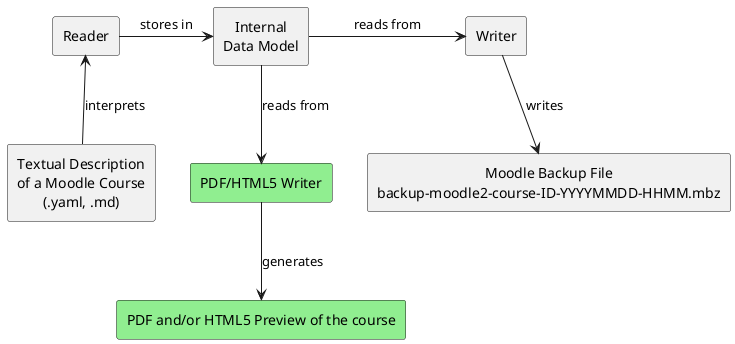

# VS Code Plugin für Kurserstellung

# Course Preview Function
In the final version of Course As Code, users should be able to generate a course preview before importing it into Moodle. This allows potential issues to be identified prior to the Moodle import and supports the course creation process.

Suitable formats for the preview include both PDF (more complex) and HTML/CSS (simpler). Due to the architecture of Course As Code, this feature can be implemented relatively easily as well as independently of the rest of the development by 1-2 team members working in parallel to the other development efforts. The Reader, internal data model, and Writer operate completely independently of one another.

To implement this functionality, the existing Writer component - which currently converts data read by the Reader and stored in the internal data model into XML files and subsequently into a Moodle backup file - simply needs to be replaced by a newly developed component (green) that converts the data into a `.pdf` or `.html` file.

# Cascading Config bzw. sinnvolle Defaults (WIP)

# Verbesserte UX

# Support für mehrere Moodle Versionen
