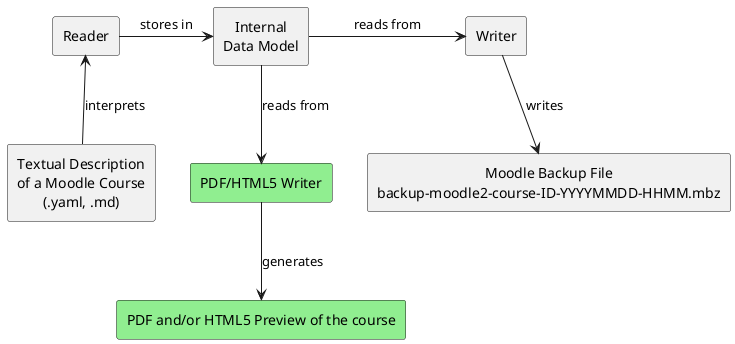

# VS Code Plugin for Course Creation
Course As Code allows Moodle courses to be created in the form of text files. This enables courses to be managed using source control tools like Git and also facilitates easier collaboration on course creation. However, a crucial disadvantage of this approach is that there is no UI available to present configuration options to the user in a simple manner.

Instead, the entire configuration takes place via `.yaml` files. While this text-based approach provides the aforementioned advantages regarding version control, it is no longer immediately apparent to the user which options are available and which values individual configuration parameters can or may accept.

For this reason, a plugin for [Visual Studio Code](https://code.visualstudio.com/) is to be developed that provides IntelliSense-like functions when writing the text files for a Moodle course, such as code completion for individual parameters, displaying documentation for specific parameters, showing possible values for parameters, highlighting syntax errors, etc.

!!! tip
    A preliminary Proof of Concept implementation of this feature could potentially be realized using JSON/YAML schemas. In VS Code, such a schema can be integrated using the `$schema` keyword and would likewise offer validation, auto-completion, and documentation, while being significantly less effort to create than a complete VS Code plugin.

# Course Preview Function
In the final version of Course As Code, users should be able to generate a course preview before importing it into Moodle. This allows potential issues to be identified prior to the Moodle import and supports the course creation process.

Suitable formats for the preview include both PDF (more complex) and HTML/CSS (simpler). Due to the architecture of Course As Code, this feature can be implemented relatively easily as well as independently of the rest of the development by 1-2 team members working in parallel to the other development efforts. The Reader, internal data model, and Writer operate completely independently of one another.

To implement this functionality, the existing Writer component - which currently converts data read by the Reader and stored in the internal data model into XML files and subsequently into a Moodle backup file - simply needs to be replaced by a newly developed component (green) that converts the data into a `.pdf` or `.html` file.

# Cascading Config bzw. sinnvolle Defaults (WIP)

# Verbesserte UX

# Support für mehrere Moodle Versionen
