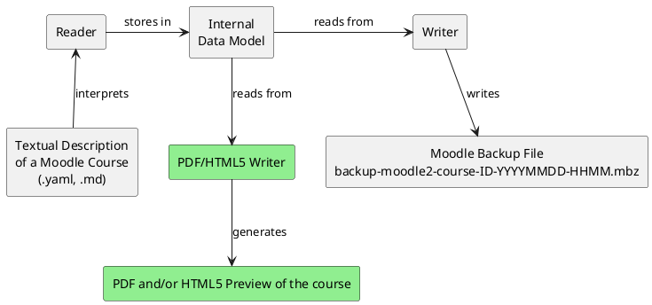

## VS Code Plugin for Course Creation
Course As Code allows Moodle courses to be created in the form of text files. This enables courses to be managed using source control tools like Git and also facilitates easier collaboration on course creation. However, a crucial disadvantage of this approach is that there is no UI available to present configuration options to the user in a simple manner.

Instead, the entire configuration takes place via `.yaml` files. While this text-based approach provides the aforementioned advantages regarding version control, it is no longer immediately apparent to the user which options are available and which values individual configuration parameters can or may accept.

For this reason, a plugin for [Visual Studio Code](https://code.visualstudio.com/) is to be developed that provides IntelliSense-like functions when writing the text files for a Moodle course, such as code completion for individual parameters, displaying documentation for specific parameters, showing possible values for parameters, highlighting syntax errors, etc.

!!! tip
    A preliminary Proof of Concept implementation of this feature could potentially be realized using JSON/YAML schemas. In VS Code, such a schema can be integrated using the `$schema` keyword and would likewise offer validation, auto-completion, and documentation, while being significantly less effort to create than a complete VS Code plugin.

## Course Preview Function
In the final version of Course As Code, users should be able to generate a course preview before importing it into Moodle. This allows potential issues to be identified prior to the Moodle import and supports the course creation process.

Suitable formats for the preview include both PDF (more complex) and HTML/CSS (simpler). Due to the architecture of Course As Code, this feature can be implemented relatively easily as well as independently of the rest of the development by 1-2 team members working in parallel to the other development efforts. The Reader, internal data model, and Writer operate completely independently of one another.

To implement this functionality, the existing Writer component - which currently converts data read by the Reader and stored in the internal data model into XML files and subsequently into a Moodle backup file - simply needs to be replaced by a newly developed component (green) that converts the data into a `.pdf` or `.html` file.

## Cascading Config and Sensible Defaults (WIP)
One of the core design goals of Course As Code is to make course creation easier and faster than is traditionally the case in Moodle. One of the most important concepts for achieving this goal is the so-called **Cascading Config** and the use of sensible default values.

One of the most time-consuming tasks in Moodle course creation is having to manually set all necessary parameters for every activity, even though identical settings are often chosen for a wide variety of activities anyway. Course As Code aims to address this by introducing support for **Cascading Configs**:

For example, certain default settings for activities (e.g., whether they should be visible to students or whether standard instructions should be displayed for quizzes) can be set at the course level, which are then automatically inherited by all other activities (or any other entity configurable via Course As Code) in this course. This means that these settings no longer need to be set for every single activity; instead, they are simply inherited from the parent configuration (which could also have the scope of a single section instead, for example).

However, the user still has the option to set configuration parameters for a single activity, thereby overriding the global defaults if they wish to apply varying settings for a specific activity.

!!! info "Handling Missing Default Configuration"
    If the user does not provide such global (or section-level) standard settings, Course As Code should instead set reasonable default parameters so that the course can still be created without triggering error messages. Although, in this situation, Course As Code obviously has to guess which settings the user desires.
    
    !!! tip "Omitting Config Files"
        Ideally, it should even be possible to omit certain configuration files (e.g., the configuration file for a specific activity) entirely if the user is satisfied with the default settings or simply wants to inherit them from a higher level (**Cascading Config**). This significantly increases the clarity of the course definitions.

!!! abstract "Current Status"
    The concept of **Cascading Config** and the use of sensible default values is already partially implemented in the current version of Course As Code. However, the implementation is inconsistent and incomplete in some places, which is why further work is required here.

## UX Improvements
Although priority was already given to user-friendliness during the implementation of the Readers, some parameters and configuration files are not yet optimally designed, and some settings lack consistency across the entire application. A major factor in this regard is the usage of IDs. The current Reader implementation assigns internal IDs to many entities (e.g., activities, quiz questions, etc.). To link these elsewhere (e.g., a hyperlink to an activity, inclusion of a quiz question in a quiz), the user currently has to specify the entity's ID to establish the link.

This approach is relatively cumbersome and user-unfriendly, as the user is required to memorize arbitrary IDs to create the course. Therefore, a simpler system should be introduced to enable the user to create links within their course. So far, the most promising ideas appear to be specifying the path to the activity instead of the ID, and/or giving the user the option to define a text-based "label" for an entity, which they could then reference instead of the ID.

!!! tip
    In our view, it is not necessary to completely refactor the Readers to implement this feature. The fact that the Readers operate internally with IDs is a sound design decision for reasons of performance and avoiding collisions/ambiguities. However, they should provide an abstraction layer for the user so that they do not have to work directly with these IDs. This could be implemented, for example, by creating a mapping table that maps paths/labels to IDs.

## Support for Multiple Moodle Versions
Major Moodle versions (e.g. Moodle 4.X -> 5.X) often introduce breaking changes that alter how backups are stored within a Moodle backup file (`.mbz`). For example, the internal storage method for Question Banks changed between Moodle 4.X and Moodle 5.X. Consequently, Course As Code must be adapted to function with Moodle 5.X; see ["Error Messages During Imports in Moodle 5.X"](./Known_Issues.md#error-messages-during-imports-in-moodle-5x) for further information.

However, to ensure that adapting to the new format expected by Moodle 5.X (and following major versions) does not result in a loss of backward compatibility with Moodle 4.X or other earlier versions, Course As Code should allow the user to select the target Moodle version when generating the backup file.