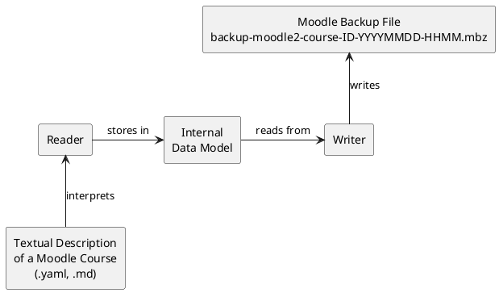

# Course as Code - Developer Wiki
Course as Code is a tool that enables the creation of Moodle courses through text formats such as YAML or Markdown (hence the name _Course as Code_). These text files can then be converted into a Moodle backup file (.mbz), which may be imported directly into Moodle as a complete course. This approach allows fully functional Moodle courses to be created and edited using any text editor, while changes and collaboration can be managed efficiently with version control systems like Git.

Course as Code is a modular application that, broadly speaking, consists of three main components:

- A Reader component that reads text files and stores the information in an internal data model
- An internal data model that uses classes to represent a Moodle course along with all its supported components
- A Writer component that subsequently writes the information stored in the internal data model into the .xml files required by Moodle

## Running the application
TODO: Add instructions for running the application